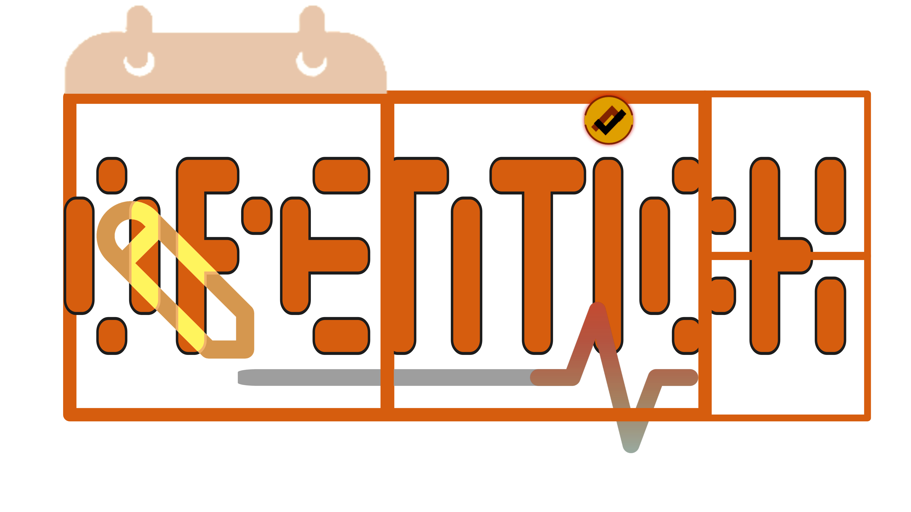
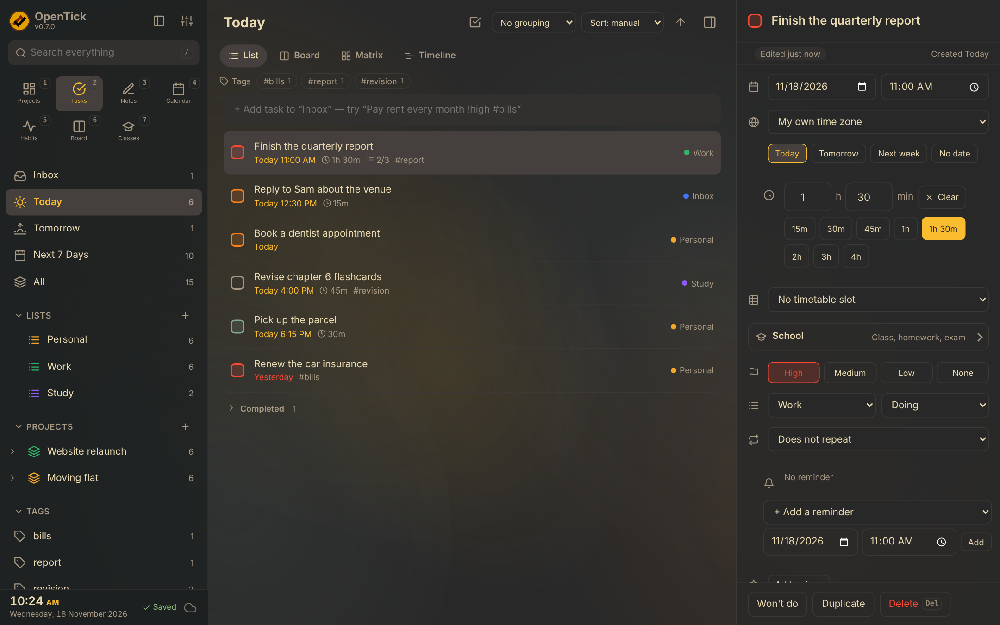
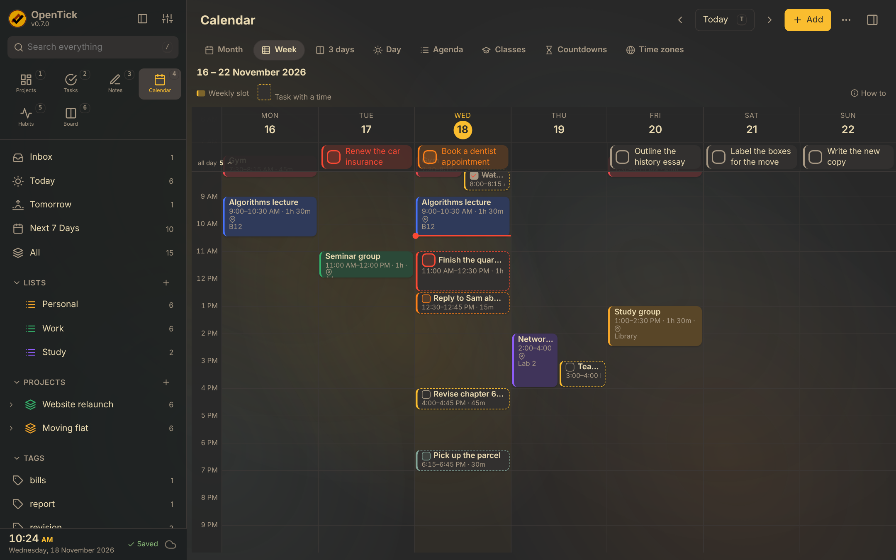
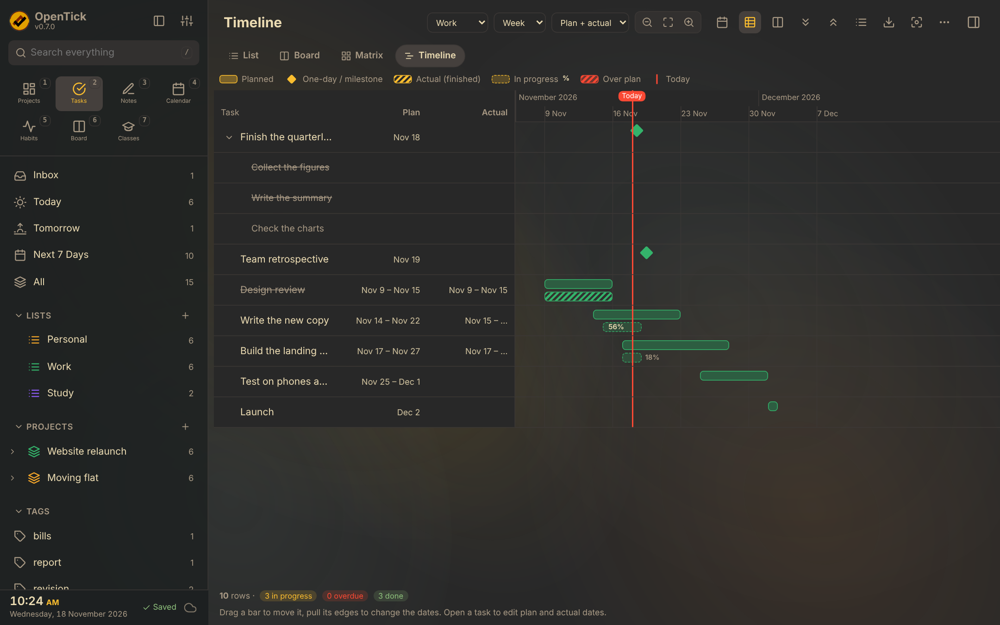
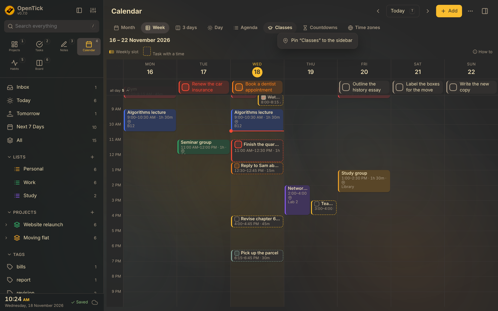
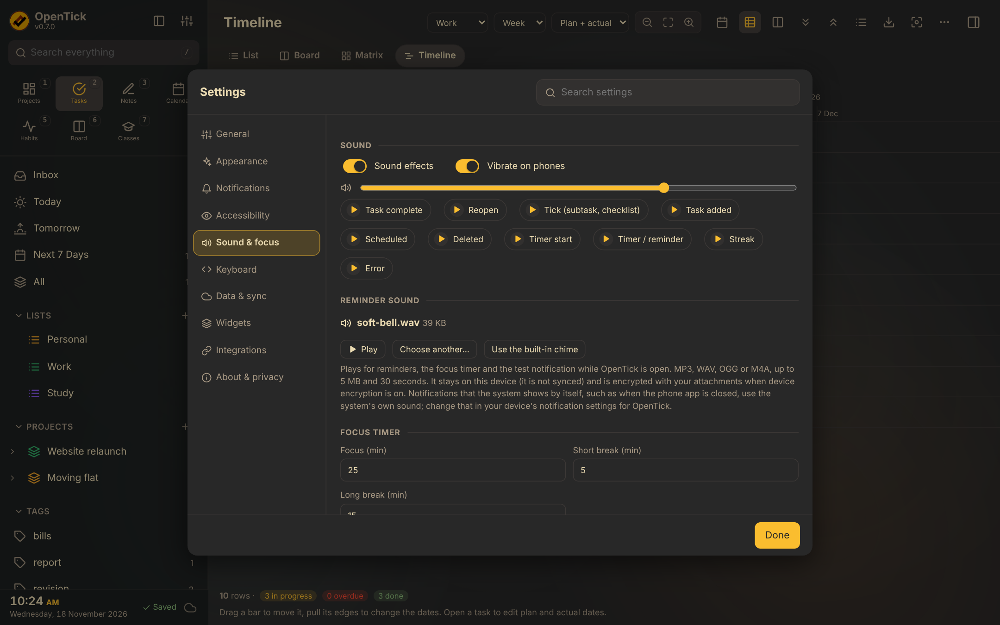
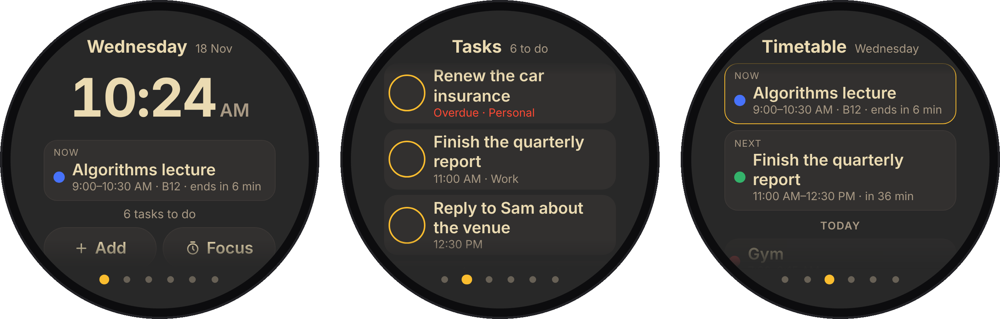
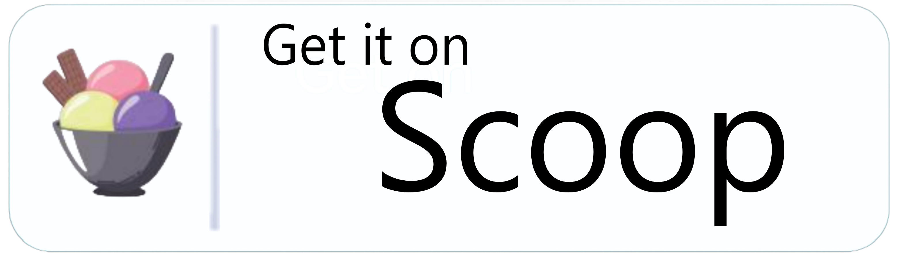

<div align="center">
  

  **A TickTick-style task manager that runs everywhere from one codebase.**

  Plan your day, manage projects and track habits from one codebase. OpenTick is local-first, works offline, and does not require an account, subscription or hosted sync server.
  
---
***Currently AI generated***;
- I intend on one-day "reverting" this project and human-tweaking it until eventually the AI work is subdued (like the ship of Theseus in a way).
---

  <a href="https://unlicense.org"></a>
  <a href="https://tauri.app"></a>
  <a href="https://web.dev/progressive-web-apps/"></a>
  <a href="https://github.com/JebbyCodes/OpenTick/releases/latest"></a>
  <a href="https://github.com/JebbyCodes/OpenTick/actions/workflows/ci.yml"></a>
  <a href="https://github.com/JebbyCodes/OpenTick/actions/workflows/release.yml"></a>
</div>

<p align="center">
  
  
  
</p>
<p align="center">
  
  
</p>
<p align="center">
  
</p>

## Download
Get the latest version from [GitHub Releases](https://github.com/JebbyCodes/OpenTick/releases/latest), or choose a platform-specific option below.

<div align="center">
  
### Windows

| Microsoft Store | GitHub Releases |
|:---:|:---:|
| <a href="https://apps.microsoft.com/detail/9pdnntk8tz39?hl=en-GB&amp;gl=GB"></a> | <a href="https://github.com/JebbyCodes/OpenTick/releases/latest"></a> |

| Chocolatey | Scoop |
|:---:|:---:|
| <a href="https://community.chocolatey.org/packages/opentick"></a> | <a href="https://github.com/JebbyCodes/OpenTick-Scoop"></a> |

### Android

| Orion Store | Obtainium |
|:---:|:---:|
| <a href="https://rookieenough.github.io/Orion-Data/redirect.html?id=opentick&amp;icon=https%3A%2F%2Fraw.githubusercontent.com%2FJebbyCodes%2FOpenTick%2Frefs%2Fheads%2Fmain%2Fsrc%2Flogo.png"></a> | <a href="https://apps.obtainium.imranr.dev/redirect?r=obtainium%3A%2F%2Fapp%2F%7B%22id%22%3A%22com.opentick.app%22%2C%22url%22%3A%22https%3A%2F%2Fgithub.com%2FJebbyCodes%2FOpenTick%22%2C%22author%22%3A%22JebbyCodes%22%2C%22name%22%3A%22OpenTick%22%2C%22preferredApkIndex%22%3A0%2C%22additionalSettings%22%3A%22%7B%5C%22includePrereleases%5C%22%3Atrue%2C%5C%22fallbackToOlderReleases%5C%22%3Atrue%2C%5C%22enableVirusTotalScan%5C%22%3Atrue%2C%5C%22observedVersionName%5C%22%3A%5C%220.4.0%5C%22%2C%5C%22observedVersionCode%5C%22%3A4000%2C%5C%22observedPackageId%5C%22%3A%5C%22com.opentick.app%5C%22%7D%22%7D"></a> |

| GitHub Releases |
|:---:|
| <a href="https://github.com/JebbyCodes/OpenTick/releases/latest"></a> |

### Linux

| Snap Store | GitHub Releases |
|:---:|:---:|
| <a href="https://snapcraft.io/opentick"></a> | <a href="https://github.com/JebbyCodes/OpenTick/releases/latest"></a> |

### macOS & Web

| GitHub Releases |
|:---:|
| <a href="https://github.com/JebbyCodes/OpenTick/releases/latest"></a> |
</div>

### Which file do I want?

Every release lists these with sizes, and a `SHA256SUMS.txt` to check them against.

| You have | Download |
|---|---|
| Windows 10 / 11, 64-bit | `OpenTick_x.y.z_x64-setup.exe` (or the `.msi`; `_x64-portable.zip` needs no install) |
| Windows, 32-bit or ARM | `_x86-setup.exe` or `_arm64-setup.exe` |
| Mac (Apple Silicon or Intel) | `OpenTick_x.y.z_universal.dmg` (not notarised: right-click → Open the first time) |
| Linux, 64-bit | `_amd64.AppImage` (any distro), `.deb` (Debian, Ubuntu), `.rpm` (Fedora, openSUSE) or the Snap |
| Linux ARM (Raspberry Pi 4/5, ARM laptops) | `_aarch64.AppImage`, `_arm64.deb`, `.aarch64.rpm` or the ARM64 Snap |
| Android phone or tablet | `_android-universal.apk` works everywhere. Smaller: `_android-arm64-v8a.apk` (modern), `_android-armeabi-v7a.apk` (older, 32-bit), `_android-x86_64.apk` / `_android-x86.apk` (Intel, emulators) |
| Android e-ink device | `_android-eink-universal.apk` (see [E-ink](#e-ink)) |
| Wear OS watch (Pixel Watch, Galaxy Watch 4 and later, TicWatch…) | `_android-watch-universal.apk` (see [Smartwatches](#smartwatches)) |
| Samsung Tizen watch (Galaxy Watch 3 and earlier) | `_tizen-unsigned.wgt`: you sign it yourself first (see [Smartwatches](#smartwatches)) |
| iPhone / iPad | `.ipa` (only when the maintainers' Apple signing is set up; see [docs/RELEASING.md](docs/RELEASING.md)) |
| A server, NAS or any old machine with a browser | Docker, or `_web.zip` (`_web-eink.zip` and `_web-watch.zip` are the e-ink and smartwatch editions) |

Android 7 or newer, Windows 10 or newer and macOS 10.15 or newer are needed. Windows 7/8 and 32-bit Linux are not supported by Tauri 2's web view; use the Docker image or the web app there. Obtainium users can add `apkFilterRegEx` = `universal` (or `arm64-v8a`) to pick one APK from each release.

### Docker

```sh
docker run -d -p 8080:8080 --name opentick ghcr.io/jebbycodes/opentick:latest
```

Open http://localhost:8080 (the e-ink edition is at `/eink/`, the smartwatch edition at `/watch/`). Images exist for 64-bit and 32-bit x86, ARM64 and ARMv7. Your data stays in your browser; the container only serves the app. [`docker/compose.example.yml`](docker/compose.example.yml) is a ready-made compose file.

Every [release](https://github.com/JebbyCodes/OpenTick/releases) also has the image as plain downloads, so you can install without the registry: `OpenTick_<version>_docker-amd64.tar.gz` (also `arm64`, `armv7`, `i386`) loaded with `gunzip -c <file> | docker load`, and a compose file pinned to that version (`OpenTick_<version>_docker-compose.yml`).

## What's new in 0.8.0

**Fixed**
- Fixed: **pressing Calendar lit the wrong button and opened Classes** when you had a view pinned (for example Classes). Calendar, or whichever section sits fourth, now lights up when you press it and opens itself. A pinned view is lit only when you pressed that pin, so two buttons are never lit at once.
- Fixed: **the "Next" line on a project card did not scroll to its end.** Long names that slide sideways (calendar chips, timetable blocks, task rows in a narrow window, the project card) now always travel to their real last letter. The old version measured the text in advance and could stop short.
- Fixed: a menu or a tooltip no longer closes by itself while a long name is sliding past.
- Fixed: the phone's tab bar fits six sections and **More** on a small screen, and More stays at the end when pins make the bar scroll. The printed Help guide's contents list is in two columns again.

**App**
- New: **drag a long name with your hand.** A name that is too long and slides can now be moved yourself: drag it with the mouse, swipe it on a touch screen, use a trackpad or Shift + mouse wheel. It holds still while you read and carries on a moment after you let go. With Animations off or "reduce motion" it does not move by itself but can still be dragged.
- New: **pinned views are part of the sections' order.** Drag a pin among the sections, or use **Move earlier / Move later** in its right-click (or press-and-hold) menu, or the arrows in Settings → Layout. One order for the sidebar and the phone's tab bar, kept on each device.
- New: **Contacts**, a book of the people you work and study with: name, nickname, role, organisation, any number of labelled emails and phone numbers, website, address, birthday, time zone, notes and tags, and **available hours** (the card says "Available now · until 3:00 PM" or "Free tomorrow from 9:00 AM", worked out in their time zone). Filter by available now, favourites, tags or class contacts; sort and search. Email and phone buttons open your own mail and phone apps; OpenTick sends nothing.
- New: **link people to your work.** A task, a note, a class or a section entry can be linked to any number of people, and the person's page lists everything linked to them. Write `@[Name]` in a note (or type `@` in the block editor, or use the Mention button in the toolbar) for a link to their page; rename a person and mentions follow. In the task box, `+anna` links a person ("Send the report +anna tomorrow").
- New: **teachers are contacts.** Every teacher in Classes is also a contact, with name, email and phone shared both ways, grouped as **Class contacts** on the Contacts page. Existing teachers become contacts the first time you open 0.8.0.
- New: **your own sections.** Make a section for anything (a reading list, recipes, spending, gift ideas, workouts) with the fields you choose: text, note, number, date, tick box, choice, rating, link or tags. Show it as a list, cards or a table, sort and group it, give it a colour and icon, search it, link people, pin it, hide it, use it as your start screen. **Add a section…** is in Settings → Layout and the command palette; seven templates are built in.
- New: **packs.** Settings → Sections & packs exports your sections as one small file, and adds a pack someone sent you (a file or pasted text). A pack holds only sections, starter entries and colours: no code, no internet, no access to your data, and it never switches your theme. Adding a pack always makes new sections and never overwrites yours. Four sample packs are in the repository's `marketplace/` folder (study planner, garden journal, home maintenance, calm themes) and published at `/marketplace/` on the website. A marketplace for packs and themes is planned and will use these same files; the author guide is `docs/PACKS.md`.
- Changed: search (Ctrl + K) finds people and your own sections' entries; the start screen can be Contacts or one of your sections; the Help page has chapters for Contacts and for sections and packs; the privacy policy covers both.

**Releases**
- New: **Prepare release** workflow (Actions → Prepare release). Type the version and it bumps every file, pushes `release/vX.Y.Z` and opens a pull request with a checklist; it never tags or publishes.
- New: **every release run ends with a status table** of all stages (required or optional, passed or failed), GitHub's release notes are grouped by pull request label (`.github/release.yml`), and CI checks the pack library (`npm run packs:check`), which the website also serves.
- Changed: `docs/RELEASING.md` is reorganised (quick start, what a run does, the workflows, release notes, CI, secrets, platform notes, troubleshooting).

**Sync and encryption**
- **The sync file is now schema 7.** It adds contacts, your sections and their entries, and the people linked to tasks, notes and classes. **Update every device to 0.8.0 before syncing between them:** an older version refuses a file written by a newer one ("please update this app") rather than guessing, and a 0.8.0 device reads an older file as having no contacts or sections and keeps its own. Deleting a contact or a section is carried to the other devices like any other deletion.
- Contacts, sections and entries are encrypted, backed up, exported and synced like tasks and notes: sealed when encryption is on and re-sealed when it is turned on, off or re-keyed. Tests cover every collection, merging edits from two devices, and encryption on and off.
- The layout (the order of sections and pins) stays a setting of the device and is never part of the sync file.

Earlier releases are listed in [CHANGELOG.md](CHANGELOG.md).

## E-ink

For e-paper tablets and readers (Boox, reMarkable-style browsers, Kindle browsers, Kobo…): Settings → Appearance → **E-ink display** switches to black on white with outlines instead of colour, no animation or shadows, bigger touch targets, marks instead of colour, and **page up / down buttons** on the edge for scrolling without a flick. *Automatic* turns it on for known e-reader browsers and for the e-ink builds below.

- **Android:** `_android-eink-universal.apk` from a release starts in e-ink mode (it can be turned off in Settings).
- **Web:** open `/eink/` on the hosted site, in the Docker image, or in `_web-eink.zip`. Any other browser can add `?eink` to the address.

## Smartwatches

The **smartwatch layout** is the same app, data, sync and encryption drawn for a small round or square screen: six full-screen pages you swipe between (Now, Tasks, Next, Habits, Focus, More) with a big tick for each task, Add by typing or dictating, the day's timetable, habit check-ins and the focus timer.

- **Wear OS 3 or newer** (Pixel Watch, Galaxy Watch 4 and later, TicWatch and others): `_android-watch-universal.apk` from a release, installed with `adb`.
- **Samsung's older Tizen watches:** `_tizen-unsigned.wgt`. Samsung only runs apps signed with the installer's own certificate, so it is published unsigned. This one is experimental.
- **Web:** open `/watch/` on the hosted site, in the Docker image, or in `_web-watch.zip`. Any other browser can add `?watch` to the address, or choose Settings → Appearance → **Smartwatch layout**.
- **Not possible:** Apple Watch, Garmin, Fitbit and Zepp watches need an app written for each of them. Reminders can still reach them as the phone's notifications.

[docs/WATCHES.md](docs/WATCHES.md) has the install steps and an honest list of what has and has not been tried.

## Features

- **Tasks and lists:** priorities, tags, sections, subtasks, recurring tasks, reminders, attachments and batch editing.
- **Quick add:** natural-language dates, times, repeats, priorities, tags, lists and class markers.
- **Planning views:** calendar, kanban board, projects dashboard, Eisenhower matrix and Gantt chart.
- **Your own layout:** right-click (or press and hold) any page title or tab to pin it next to the sections, and put the sections and pins in the order you like.
- **Contacts:** the people you work and study with, with available hours, emails, phone numbers and notes, linked to tasks, notes and classes, `@mentions`, and your teachers from Classes.
- **Your own sections and packs:** make a section for anything (reading list, recipes, spending) with the fields you choose, and share sections and colour themes as small files. A marketplace for packs is planned; the sample library is in [`marketplace/`](marketplace/) and the format in [docs/PACKS.md](docs/PACKS.md).
- **Timetable and Classes:** recurring weekly slots, lessons, A/B weeks, days off, exams and homework.
- **Habits and focus:** streaks, history charts, and a Pomodoro timer with session tracking.
- **Reminders:** several per task, in the background on every platform, with a sound of your choosing.
- **Markdown notes:** preview, checklists, note links, attachments and import/export.
- **Customisation:** themes, custom CSS themes, colours, banners, adjustable panels and keyboard shortcuts.
- **Widgets:** desktop mini-window, Android home-screen widgets (tasks, lists, projects, notes, calendar, timetable, matrix, habits, countdowns, focus) and a compact web widget.
- **Offline-first storage:** data stays on your device unless you enable sync.
- **Optional encryption:** AES-256-GCM encryption for selected local data, backups and cloud sync, protected by a passphrase and recovery key.
- **Flexible sync:** WebDAV or a JSON file in a folder synced by another app; additional Git and S3-compatible providers are available.
- **Import and export:** JSON backups and imports from several task and note formats.
- **Updates on your terms:** an optional update check, off by default; nothing is ever downloaded or installed for you.

## Platforms

| Platform | How to run it |
|---|---|
| Web / PWA | Use the hosted site, the Docker image or `_web.zip` (serve over HTTPS for PWA install), or build `dist/` yourself. |
| Windows | Installer, MSI, portable zip or Store package; 64-bit, 32-bit and ARM64. |
| macOS | Universal `.dmg` (Apple Silicon and Intel). |
| Linux | AppImage, `.deb`, `.rpm` or Snap; 64-bit and ARM64. |
| Android | Universal APK, per-CPU APKs (including 32-bit ARM), an App Bundle, an e-ink APK and a Wear OS APK. |
| iOS | `.ipa` built with Apple signing configured, or build from source in Xcode. |
| E-ink | Android e-ink APK, the `/eink/` web edition, or E-ink display in Settings. |
| Smartwatch | Wear OS APK, an unsigned Tizen package, the `/watch/` web edition, or Smartwatch layout in Settings. |

## Build from source

### Requirements

- [Node.js](https://nodejs.org/)
- For desktop builds: [Rust](https://www.rust-lang.org/) and the [Tauri prerequisites](https://tauri.app/start/prerequisites/)
- For Android: Android SDK/NDK and Java
- For iOS: macOS, Xcode and Apple signing configuration

### Web / PWA

```sh
git clone https://github.com/JebbyCodes/OpenTick.git
cd OpenTick
npm install
npm run build:app
```

The built app is in `dist/`. Serve that directory over HTTPS to enable PWA installation and service-worker features.

### Development

```sh
npm install
npm run dev
```

### Desktop

```sh
npm run icons
npm run tauri dev
npm run tauri build
```

### Android

```sh
npx tauri android init
npx tauri android dev
npx tauri android build --apk
```

### iOS

```sh
npx tauri ios init
npx tauri ios dev
npx tauri ios build
```

iOS device builds need signing configured in Xcode. For platform-specific setup, follow the [Tauri documentation](https://tauri.app/).

## Data and privacy

OpenTick stores tasks and settings locally by default. Sync is optional.

- **Local data:** app data is stored in browser storage; attachments use IndexedDB.
- **Backups:** export your data to JSON and use the app's automatic local snapshots.
- **Sync:** use WebDAV or a supported file/provider option. Keep device clocks reasonably accurate because record conflicts are resolved using timestamps.
- **Encryption:** optional. Keep your recovery key somewhere safe; encrypted data cannot be recovered without the passphrase or recovery key.
- **WebDAV:** use HTTPS, especially on Android. Web/PWA sync can also require the server to allow browser CORS requests.

## Tests

Run the main test suite:

```sh
npm test
```

Browser tests (Python + Playwright with Chromium) run with `npm run test:browser`. `npm run lint:workflows` checks the GitHub workflow files, and `npm run version:check` confirms every file carries the same version.

## Project structure

- `src/` — application HTML, CSS and JavaScript
- `src-tauri/` — Tauri desktop/mobile shell and platform assets (`android-widgets/` holds the Android Kotlin and XML)
- `test/` — Node test suites; `test/browser/` has the Playwright tests
- `scripts/android/` — widget and service installer, signing, version check, APK naming
- `scripts/release/` — `bump-version.mjs` (`npm run bump` / `version:sync`), release notes, asset collection
- `scripts/legal/` — licence and privacy-policy generators
- `scripts/assets/`, `scripts/ci/` — icon generation and the README screenshots (`readme-screenshots.py`); the workflow linter
- `scripts/watch/` — the Tizen smartwatch package (`make-tizen-wgt.mjs`)
- `packaging/msix/` — Microsoft Store package: manifest, assets, `build-msix.ps1`, `bundle-msix.ps1`
- `snap/` — `snapcraft.yaml` (builds from source) and `ci/` + `local/` (wraps the CI-built `.deb`)
- `Dockerfile`, `docker/` — the self-hosting image
- `.github/workflows/` — `ci`, `release`, `build-*`, `publish-*`, `deploy-pages` (see [docs/RELEASING.md](docs/RELEASING.md))
- `docs/` — privacy policy, F-Droid recipe, release guide, smartwatch guide
- `build-app.mjs` — creates the self-contained web build (`--eink` for the e-ink edition, `--watch` for the smartwatch edition, `--out <dir>`)
- `package.json` — project version and commands

## Contributing

Bug reports and feature requests are welcome in [GitHub Issues](https://github.com/JebbyCodes/OpenTick/issues). For code changes:

1. Fork the repository and create a branch.
2. Run `npm install` and `npm test`.
3. Explain user-visible changes in the pull request and update `CHANGELOG.md` when appropriate.

## License

OpenTick is released under the [Unlicense](https://unlicense.org/). You can copy, modify, distribute and use it commercially.

## Acknowledgements

- [Tauri](https://tauri.app/) for the native application shell.
- The open-source *Timetable* app for the lesson-timetable model behind Classes.
- The authors of the themes and open-source projects whose formats OpenTick supports.
