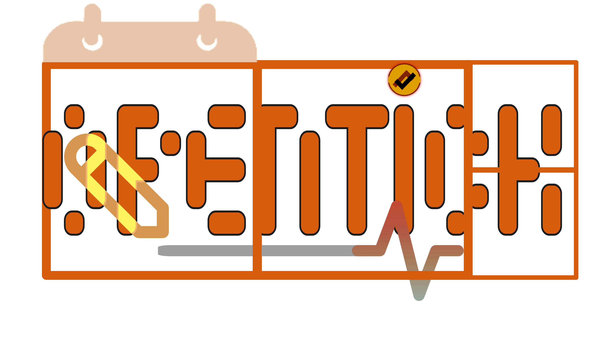
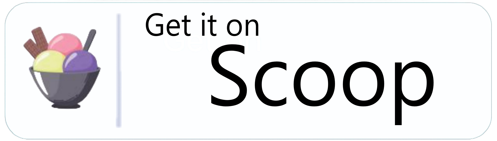
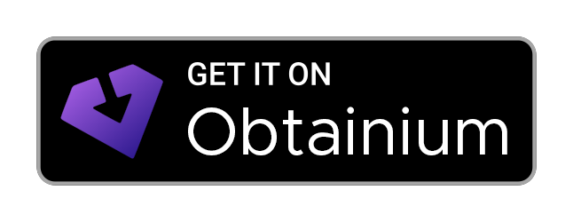
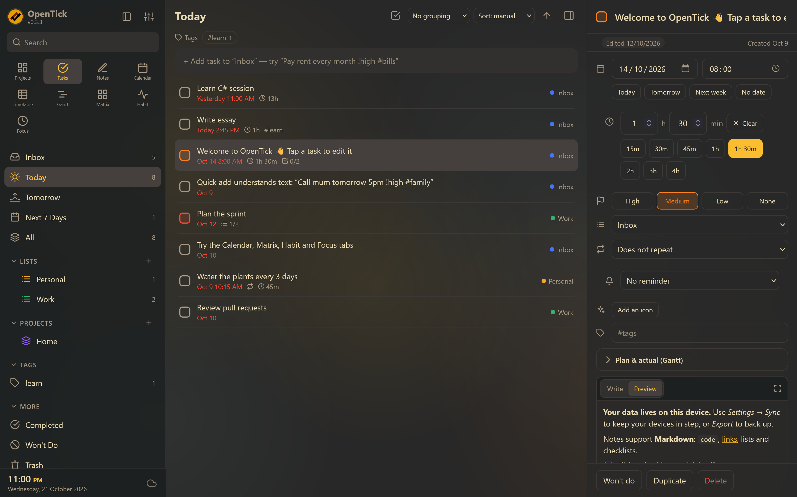
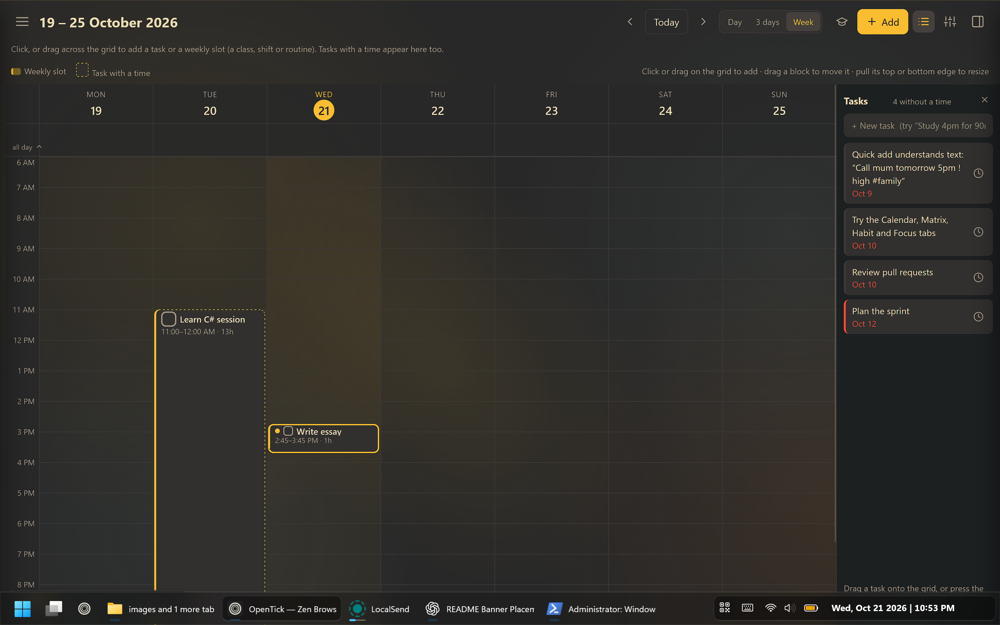
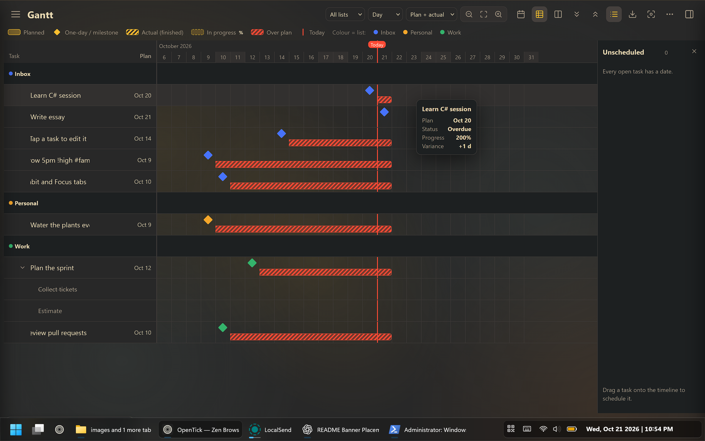

<div align="center"><p><strong>A TickTick-style task manager that runs everywhere from one codebase.</strong></p><p>Plan, schedule and track your day on the web, your desktop and your phone — without an account, a subscription or a server you don't own.</p><p>
  <a href="https://unlicense.org"></a>
  <a href="#platforms"></a>
  <a href="https://tauri.app"></a>
  <a href="https://web.dev/progressive-web-apps/"></a>
  <a href="#project-layout"></a>
  <a href="#testing"></a>
  <a href="#a-note-on-ai"></a>
  <a href="#contributing"></a>
</p><p>
---
  
### Windows

| Microsoft Store | GitHub Releases | Chocolatey | Scoop |
|:---:|:---:|:---:|:---:|
| <a href="https://apps.microsoft.com/detail/9pdnntk8tz39?hl=en-GB&amp;gl=GB"></a> | <a href="https://github.com/JebbyCodes/OpenTick/releases/latest"></a> | <a href="https://community.chocolatey.org/packages/opentick"></a> | <a href="https://github.com/JebbyCodes/OpenTick-Scoop"></a> |

### Android

| Orion Store | Obtainium |
|:---:|:---:|
| <a href="https://rookieenough.github.io/Orion-Data/redirect.html?id=opentick&amp;icon=https%3A%2F%2Fraw.githubusercontent.com%2FJebbyCodes%2FOpenTick%2Frefs%2Fheads%2Fmain%2Fsrc%2Flogo.png"></a> | <a href="https://apps.obtainium.imranr.dev/redirect?r=obtainium%3A%2F%2Fapp%2F%7B%22id%22%3A%22com.opentick.app%22%2C%22url%22%3A%22https%3A%2F%2Fgithub.com%2FJebbyCodes%2FOpenTick%22%2C%22author%22%3A%22JebbyCodes%22%2C%22name%22%3A%22OpenTick%22%2C%22preferredApkIndex%22%3A0%2C%22additionalSettings%22%3A%22%7B%5C%22includePrereleases%5C%22%3Atrue%2C%5C%22fallbackToOlderReleases%5C%22%3Atrue%2C%5C%22enableVirusTotalScan%5C%22%3Atrue%2C%5C%22observedVersionName%5C%22%3A%5C%220.4.0%5C%22%2C%5C%22observedVersionCode%5C%22%3A4000%2C%5C%22observedPackageId%5C%22%3A%5C%22com.opentick.app%5C%22%7D%22%7D"></a> |

### Web, Linux & macOS

| GitHub Releases |
|:---:|
| <a href="https://github.com/JebbyCodes/OpenTick/releases/latest"></a> |
---
</p><p>
  <a href="#features">Features</a> ·
  <a href="#platforms">Platforms</a> ·
  <a href="#installation">Install</a> ·
  <a href="#quick-start">Quick start</a> ·
  <a href="#building-from-source">Building</a> ·
  <a href="#sync">Sync</a> ·
  <a href="#keyboard-shortcuts">Shortcuts</a> ·
  <a href="#contributing">Contributing</a> ·
  <a href="CHANGELOG.md">Changelog</a>
</p></div>

--- 

  <p align="center">
    
    
    
  </p>

## What's new in 0.4.0

- **Optional encryption** (Settings → Encryption). AES-256-GCM with a passphrase and a recovery key, applied before anything is stored, backed up or synced. Choose what it covers: this device, backup files, cloud sync. The cloud icon shows a padlock while sync encryption is on. See Encryption.
- **Classes** replaces the *School timetable*, and you can rename it (Lessons, Courses, Lectures…). New *Today*, *Day* and *Week* pages show start and end times, "ends in" and "next up", and fit the screen without scrolling text.
- **One timetable.** Lessons are drawn on the main Timetable beside slots and tasks, and tasks can sit on top of a lesson.
- **Exams and homework are ordinary tasks**: file them in any list, sublist or project. Quick add understands `@subject`, `/exam` and `/hw`. Old school data is converted automatically.
- **Phone notes** open the note itself full screen, with the other controls tucked away. The habit icon is centred.
- The sync file is now `schema: 4`; older apps refuse it instead of dropping or exposing data.

## Table of contents

- Why OpenTick
- Features
- Platforms
- Installation
- Quick start
- Building from source

- Web / PWA
- Desktop
- Android
- iOS and macOS
- Application icons
- Testing
- Sync

- How merging works
- WebDAV
- A file in a synced folder
- Adding a provider
- Encryption
- Gantt
- Timetable
- Markdown
- Themes
- Keyboard shortcuts
- Project layout
- Architecture
- CI and releases
- Your data
- Contributing
- A note on AI
- License
- Acknowledgements

---

## Why OpenTick

Most task managers make you pick a side: a polished desktop app **or** a phone app **or** a website — and then they hold your data. OpenTick is one small codebase that ships to all six of them, stores everything locally by default, and syncs through *your* WebDAV server or *your* existing Dropbox/Syncthing/iCloud folder.

- **One front end, every platform.** The entire UI is plain HTML, CSS and JavaScript with **zero runtime dependencies**. Tauri 2 wraps it in a native shell for desktop and mobile; the browser runs the exact same files as an installable PWA.
- **Offline-first, local-first.** Data lives on the device in `localStorage`. Sync is opt-in and never required.
- **No lock-in.** One JSON export contains everything, readable with a text editor.
- **Free as in public domain.** The [Unlicense](https://unlicense.org/) — copy it, fork it, sell it, ship it.

---

## Features

### Capture and organise

- **Smart lists** — Inbox, Today, Tomorrow, Next 7 Days, All, Completed, Won't Do, Trash.
- **Lists, sections, tags and sub-tasks** with priorities (none / low / medium / high), due date + time, and drag-to-reorder rows.
- **Lists and projects** — pick any icon (or any emoji) and a colour; lists nest inside lists to any depth. Link lists into projects to see them together with progress and per-list grouping.
- **Natural-language quick add.** Type a sentence and OpenTick parses it:

```
Pay rent every month 9am !high #bills ~Personal
```

| Token | Examples |
|---|---|
| Dates | `today`, `tomorrow`, `mon`, `next week`, `in 3 days`, `dec 5`, `2026-12-05` |
| Times | `5pm`, `17:30` |
| Durations | `for 45min`, `for 1.5h` |
| Repeats | `daily`, `every 2 weeks`, `every mon, wed`, `weekdays` |
| Priority | `!high`, `!medium`, `!low` |
| Tag / list | `#bills`, `~Personal` |
| Class / type | `@physics`, `/exam`, `/hw` |
- **Repeating tasks** — completing one rolls it forward to the next date and logs the completion as a separate finished entry. Notes, linked notes and files carry forward.
- **Reminders** — native notifications on desktop and mobile, browser notifications on the web, with custom lead times from "on time" to "1 day before".
- **Markdown notes** — write / split / preview editing with a formatting toolbar, `Ctrl+B` / `Ctrl+I` / `Ctrl+K`, slash-command block menu, and Enter continues lists. Checklists in notes are clickable and show a `done/total` badge on the task row.
- **Embedding** — `![[Note title]]` embeds another note; `` on its own line becomes a player for YouTube, Vimeo, Spotify, video/audio files or PDFs.
- **Attachments** — PDFs, images, documents, spreadsheets, audio, video and more on tasks, notes and timetable slots (drop, paste, or *Add file*). Stored per device in IndexedDB; the list syncs.
- **Batch editing** — select several tasks, then change priority, date, time, duration, reminder, tags, list, repeat or status together, with **Undo**.

### Views

| View | What it gives you |
|---|---|
| **Tasks** | Grouped and sorted list, plus a per-list **board (kanban)** with sections and drag-and-drop between columns. |
| **Projects** | Home screen with a greeting, headline numbers, one card per project (progress, open/overdue, its lists, what's next), loose lists and what needs attention. |
| **Calendar** | Month / Week / Day / Agenda views with colour-coded chips per day; click a day to add a task. |
| **Timetable** | Week and day timetable with weekly recurring slots, your Classes lessons and tasks on one grid — see Timetable. |
| **Gantt** | Plan and actual bars with a table, drag-to-edit dates and print / export — see Gantt. |
| **Matrix** | Eisenhower quadrants (urgent/important) derived from due dates and priorities, each with its own quick-add box; drag a task to change its priority and date. |
| **Habit** | Daily check-ins, streaks, goals (daily or N× per week / month), and a year-long history graph. |
| **Focus** | Pomodoro timer with focus / short break / long break modes, session log, today's stats and a seven-day bar chart. |
| **Notes** | Full Markdown notes with live preview, pinning, tags, `[[links]]`, and import/export `.md`. On a phone the note opens full screen. |
| **Classes** | Your lessons as a timetable you can rename: Today, Day and Week pages with start and end times, subjects, teachers, an A/B week grid, days off, exams and homework as real tasks, notes and lesson reminders. Lessons also appear on the main Timetable. |

### Interface

- **Coloured tags** — tap a tag anywhere to give it a colour or rename it. The colour follows the tag everywhere and syncs between devices.
- **Eight themes** — Gruvbox Dark (default), Gruvbox Light, Light, Dark, Nord, Solarized Dark, Dracula, and match-the-system. All colours are CSS variables.
- **Custom themes** — import a `.css` / `.json` theme, paste CSS, or start from the downloadable template.
- **Banners** — a colour, gradient, quiet pattern or uploaded picture at the top of lists and projects.
- **Resizable, hideable panels** — drag the edge of the sidebar, details panel, timetable tray or Gantt table; double-click to reset. `[` hides the sidebar, `]` the details, `\` hides both for a distraction-free view.
- **Command palette** (`Ctrl/Cmd+Shift+P`) — jump to any view, list, tag or task, and run actions like switching theme, toggling compact density, or printing the Gantt chart.
- **Full-text search** (`/` or `Ctrl/Cmd+K`) across titles, notes and tags.
- **Responsive by default** — hidden or too-narrow panels slide in as drawers, so the same layout works on a phone.
- **Interface size** slider (80–150 %) and **Background effects** with several styles and strengths.
- **Sound effects** and haptics on phones, synthesized in the browser, with volume and on/off.
- **Widgets** — a desktop always-on-top mini window, an Android *Today* and *Add a task* home-screen widget, and a compact `?widget=1` web view.

### Data

- **Offline-first.** Nothing leaves the device unless you turn sync on.
- **Sync over WebDAV** (Nextcloud, ownCloud, Synology, Apache/nginx `dav`, …) or through **any file in a folder another tool already syncs** (Syncthing, Dropbox, OneDrive, iCloud Drive, a Nextcloud client…).
- **More providers** — Git repository (GitHub, Gitea, Forgejo, Codeberg), S3-compatible storage (AWS S3, Cloudflare R2, Backblaze B2, Wasabi, MinIO), and WebDAV presets.
- **Conflict-free by design for everyday use** — per-record last-writer-wins with tombstones, per-day habit merging and unioned focus sessions.
- **Optional end-to-end encryption** — AES-256-GCM, a passphrase and a recovery key, applied *before* data is stored, backed up or synced. You choose what is covered: this device, backup files, cloud sync. See Encryption.
- **JSON export and import** for backups and migration, with merge or replace (encrypted exports ask for the passphrase).
- **Import from other apps** — TickTick, Todoist, Google Tasks, Trello, Taskwarrior, Anytype, iCalendar / Apple Reminders, OPML, todo.txt, Markdown and generic CSV.
- **Automatic backups** — one local snapshot a day (last 7) with restore and download; encrypted too when you turn encryption on.

---

## Platforms

| Platform | Status | How you get it |
|---|---|---|
| **Web / PWA** | ✅ | Host `dist/` over HTTPS — installable from the browser. |
| **Windows** | ✅ | Installer from [Releases](https://github.com/JebbyCodes/OpenTick/releases), or build locally. |
| **macOS** | ✅ | `.dmg` / `.app` from Releases, or build locally. |
| **Linux** | ✅ | `.deb` / `.rpm` / AppImage from Releases, or build locally. |
| **Android** | ✅ | APK built with `npx tauri android build --apk`, or from Releases. |
| **iOS** | ✅ | Requires a Mac with Xcode and an Apple developer team. |

Tauri 2 produces native binaries; the front end is byte-identical across every target.

---

## Installation

### From a release

Download the installer for your platform from [Releases](https://github.com/JebbyCodes/OpenTick/releases):

- **Windows** — `.msi` or `.exe`
- **macOS** — `.dmg`
- **Linux** — `.deb`, `.rpm` or AppImage
- **Android** — `.apk`

Or install the PWA straight from your browser once `dist/` is hosted over HTTPS.

### Windows via Scoop

Install OpenTick using [Scoop](https://scoop.sh/) and the OpenTick community bucket.

**Requirements:** Windows and [Scoop](https://scoop.sh/) installed.

```powershell
scoop bucket add opentick https://github.com/JebbyCodes/OpenTick-Scoop
scoop install opentick
```

To update OpenTick later:

```powershell
scoop update
scoop update opentick
```

See the [OpenTick Scoop bucket](https://github.com/JebbyCodes/OpenTick-Scoop) for the manifest and installation details.

### From source

See Building from source.

---

## Quick start

### Try the web app (no install)

```
git clone https://github.com/JebbyCodes/OpenTick.git
cd OpenTick
npm install
npm run build:app     # bundles src/ into dist/index.html
```

Then open `dist/index.html`, or serve `dist/` from any static host. Over HTTPS it registers a service worker and becomes an installable PWA.

### Development server

```
npm install
npm run dev           # http://localhost:1420 with live rebuild on change
```

`dev-server.mjs` watches `src/` and rebuilds on every save — no bundler, no hot-reload runtime, just a `setTimeout` and a rebuild.

---

## Building from source

### Prerequisites

| Target | Needs |
|---|---|
| Web | Node.js 18+ |
| Desktop | Node.js, Rust, and the [Tauri prerequisites](https://tauri.app/start/prerequisites/) for your OS |
| Android | Android Studio / SDK + NDK and `JAVA_HOME` |
| iOS | macOS with Xcode and an Apple developer team for device builds |

### Web / PWA

```
npm run build:app
```

Bundles `src/index.html`, `src/styles.css` and every file in `src/js/` (in the order declared by `JS_ORDER`) into a single self-contained `dist/index.html`, and copies `manifest.webmanifest`, `sw.js` and `icon.svg` alongside it.

Deploy `dist/` anywhere that serves HTTPS — GitHub Pages, Netlify, a Raspberry Pi. No build server, no environment variables.

### Desktop (Windows, macOS, Linux)

```
npm run icons          # generates src-tauri/icons from src/logo.png (once)
npm run tauri dev      # development window with the live-rebuilding dev server
npm run tauri build    # installers land in src-tauri/target/release/bundle
```

### Android

```
npx tauri android init
npx tauri android dev
npx tauri android build --apk
```

The APK is written under `src-tauri/gen/android/`. Android blocks plain HTTP, so use HTTPS for WebDAV sync.

### iOS and macOS

```
npx tauri ios init
npx tauri ios dev
npx tauri ios build
```

Device builds need a signing team configured in Xcode.

### Application icons

```
npm run icons
```

Regenerates every platform icon from `src/logo.png` (falling back to `src/icon.svg` if it is missing) using the Tauri CLI. Run it once after cloning if `src-tauri/icons/` is missing pieces.

---

## Testing

```
npm test
```

Runs eighteen suites, each a plain Node script with no test framework. The main ones:

| Suite | Covers |
|---|---|
| `test/smoke.mjs` | Quick-add parser, repeat rules, and every page rendering against a fake DOM. |
| `test/markdown.mjs` | Markdown rendering, XSS safety, checklist toggling. |
| `test/sync.mjs` | Merge rules, change tracking, and two devices syncing against a mock WebDAV server. |
| `test/timetable.mjs` | Themes, tag colours, durations, timetable layout, drag/drop, reminders, merge. |
| `test/layout.mjs` | Panel sizing, sidebar views, task drops, Gantt table columns and drag date maths. |
| `test/classes.mjs` | The Classes timetable: lessons, A/B weeks, days off, the exam and homework migration, lessons in the planner, tasks on lessons. |
| `test/vault.mjs` | Encryption: key wrapping, lock and unlock, recovery, every scope, attachments, snapshots, sync logins, encrypted backups, two-device sync and tampering / downgrade attacks. |
| `test/v09.mjs` | Notes fixes, durations and reminders, custom themes, attachments, note/task links, batch editing, edited markers and the Gantt tools. |

`test/harness.mjs` loads the real app scripts into an isolated Node VM with a fake DOM, so several simulated "devices" can run side by side in one process. There is no mocking of the application code itself — the tests exercise the same files the browser runs.

More suites cover recent releases: `test/v11.mjs` (attachments: content URIs, names and types, errors, duplicates), `test/v12.mjs` (time formats and timetable layout), `test/v13.mjs` (habit dates and the history graph, run under five time zones including DST), `test/v14.mjs` (background settings and a contrast check of every theme), `test/v15.mjs` (the 0.3 features and the data the widgets read), `test/android.mjs` (the notification icon and the file permissions the app needs). `npm test` also checks that the licence list (`node scripts/licenses.mjs --check`) and every version number are up to date.

### Mock WebDAV server

```
node test/dav-mock.mjs
```

Starts an in-memory WebDAV server on `http://127.0.0.1:8080/dav` with CORS enabled — username `me`, password `secret`. Point the app's sync settings at it to try sync by hand.

### Browser tests

`npm run test:browser` drives the built app in real Chromium (layout, touch, keyboard, print-to-PDF, rendered contrast) and covers the selection bar, matrix, timetable, habits, zoom, background, icons, Help / About, the phone notes editor, the Classes pages and the lock screen. It needs `pip install playwright && playwright install chromium` and a built app (`node build-app.mjs`). It is separate from `npm test`, which has no dependencies.

---

## Sync

Sync keeps **tasks, lists, notes, projects, tag colours, timetable slots, classes, habits and focus history** identical across devices. Theme, sort/group and other view settings deliberately stay per device.

The sync file format is versioned (`schema: 4`: notes, projects, Classes and the encrypted envelope). A device running an older build refuses the file rather than silently dropping, or exposing, anything it does not understand.

### How merging works

One file, `OpenTick/opentick.json`, lives on the provider. Every sync:

1. Downloads the file and merges it with the local data.
2. Uploads the result **only if something differs**.
3. Uploads conditionally (`If-Match`) — if another device wrote in between, OpenTick re-merges and retries instead of clobbering.

Every task, list and habit records when it last changed. The most recent edit to a record wins, and deletions are remembered as tombstones for **180 days** so they are not undone by a device that still holds the old copy. Habit check-ins merge **day by day** and focus sessions are **unioned**, so nothing is lost when two devices touch the same habit. Different edits to *different* tasks never conflict; two edits to the *same* task keep the later one.

Sync runs on start, ~5 seconds after you stop editing, every 3 minutes, when the app regains focus or the network returns, and when you click the cloud icon. **Undo last merge** in the Sync dialog restores the data from immediately before the last sync brought in changes.

> Keep device clocks roughly correct — ordering is timestamp-based.

### WebDAV

Enter the server address, a folder name (created if missing), a username and an **app password**. The password is stored on this device only — never in backups, never on the server.

```
Nextcloud:  https://HOST/remote.php/dav/files/USERNAME/
```

Use HTTPS (Android blocks plain HTTP).

- **Desktop and mobile apps** send requests from native Rust code, so no server configuration is needed.
- **Web / PWA** is subject to browser CORS rules, so the server must answer preflight requests. For Nextcloud/Apache, add this for the WebDAV location:

```
Header always set Access-Control-Allow-Origin "https://your-opentick-host"
Header always set Access-Control-Allow-Headers "Authorization, Content-Type, If-Match, If-None-Match"
Header always set Access-Control-Allow-Methods "GET, PUT, MKCOL, PROPFIND, OPTIONS"
Header always set Access-Control-Expose-Headers "ETag"
```

and answer `OPTIONS` with a 2xx **without** requiring a login. If that is not possible, use the desktop/mobile app or the file provider instead.

### A file in a synced folder

Available in the desktop app and Chromium-based browsers (because it writes to disk). Choose a `.json` file inside a folder that Syncthing, Dropbox, OneDrive, iCloud Drive or a Nextcloud client already keeps in sync. Browsers ask you to re-grant file access after a restart — press **Sync now**.

### Encrypted sync

With **Cloud sync** ticked in Settings → Encryption the file on the provider is an encrypted envelope: the provider sees only scrambled bytes plus the wrapped-key header. See Encryption.

### Adding a provider

S3, Dropbox, Google Drive and friends are one object away. Add to `PROVIDERS` in `src/js/sync.js`:

```
{
  label: 'My provider',
  async read(cfg, rev)  { /* → { status: 'ok'|'nochange'|'missing', text?, rev? } */ },
  async write(cfg, text, rev, isNew) { /* → { rev } or { conflict: true } */ },
}
```

…plus its form fields in `openSync()`.

---

## Encryption

Encryption is **optional** and off by default. Turn it on in **Settings → Encryption**. While sync encryption is on, the cloud icon shows a small padlock.

- **What it protects.** Choose any of: *This device* (the stored data, attachments, automatic backups and your sync login; OpenTick asks for the passphrase when it opens), *Backup files* (exports and downloaded backups) and *Cloud sync* (the file on your server, so your provider only ever sees scrambled bytes).
- **How it is built.** Only the browser's own Web Crypto is used: no home-made cryptography and no dependency. A random 256-bit data key encrypts everything with **AES-256-GCM** (a fresh random nonce per item, text compressed first, and associated data that ties each item to your vault and its purpose). The data key is stored only *wrapped*: once by a key derived from your passphrase (**PBKDF2-HMAC-SHA256, 600 000 rounds**, random salt) and once by a random **recovery key**. In memory it is a non-extractable key.
- **Self-describing files.** Every encrypted export, snapshot and sync file carries the wrapped-key header, so it opens anywhere with just the passphrase (or recovery key). Changing the passphrase re-wraps the same data key, so older backups and your other devices keep working. To replace the data key itself, turn encryption off and on again.
- **Several devices.** Turn it on once. On every other device connect to the same sync location and type the passphrase. Sync refuses an unencrypted file that replaces an encrypted one until you confirm it.
- **Locking.** *Lock now*, lock automatically after a time away, or *Remember me on this device* to skip the prompt (the data stays encrypted in storage, but anyone using the unlocked device can read it).
- **Importing.** An encrypted backup asks for its passphrase or recovery key, then offers merge or replace as usual.
- **Widgets.** Android widgets cannot decrypt anything, so they show "Locked" unless you allow a readable summary of today in the encryption settings.
- **No reset.** Without the passphrase or the recovery key, encrypted data cannot be opened by anyone. Keep the recovery key somewhere safe.
- **Availability.** Web Crypto needs a secure context: https, localhost, or the desktop and mobile apps.

---

## Gantt

The *Gantt* tab draws your tasks as a bar for the plan (start → due; a single date is a diamond), a striped bar for the actual (actual start → the day you finished), and, for an open task with an actual start, a progress bar up to today showing the percentage of the plan elapsed. Subtasks are children (collapse with the chevron), scale is day / week / month / year, and mode is plan / actual / both. Click a bar to open the task. Set dates in a task's details under **Gantt dates** (*Start*, *Actual start*; the due date is the plan end).

- **Plan / Actual / Both**, **Day / Week / Month / Year**, zoom, a *Today* marker, hierarchy with collapse, milestones, progress for open tasks and variance / status columns.
- **Columns**: Plan, Actual, dates, durations, variance, status, **Notes, Priority, Tags**. Click a column heading for *Move left / right*, *Hide* and *Choose columns*.
- **Drag to edit**: move a plan bar, pull its edges, pull the actual's left edge, or drag an undated task from the *Unscheduled* panel onto the timeline.
- **More menu** (the `⋯` button): hide the legend, reset the view. <kbd>Ctrl/Cmd</kbd>+<kbd>P</kbd> prints.
- **Print / export** (the download button): landscape or portrait pages, light or dark colours, optional title and legend, as **PNG**, **SVG**, **CSV** or a paginated print.
- **Full screen**, and a **hover card** with plan, actual, status, progress, variance, extra fields and notes.

---

## Timetable

Open the **Timetable** tab. Slots repeat weekly, so one slot like *"Maths · Mon + Wed 09:00–10:30"* appears every week.

- **Add** — click an empty spot on the grid, or **+ Slot**. Pick days, times, colour, location, notes and an optional reminder.
- **Move / resize** — drag a block to another day or time (15-minute steps); drag its top or bottom edge to change the start or end. Moving one day of a multi-day slot moves just that day. On touch screens, press and hold a block until it lifts, then drag.
- **Overlaps** are shown side by side with a red outline and a warning in the editor.
- **Tasks on the grid** — a task due on a day with a time shows as a dashed block (duration from the task, default 30 min). Without a time it sits in the *all day* row. Drag a task from the *Tasks* tray onto the grid to schedule it, or onto *all day* to clear its time. In a task's details, **Timetable slot** links it to a slot.
- **Views** — *Week* / *Day* (click a day header), arrows, and *Today*. Quiet hours are hidden by default (6:00–22:00 plus anything scheduled and the current time, fitted to the screen height); the sliders menu turns that off for the whole day (00:00–24:00) or lets you choose your own hours. Times follow the 12 / 24-hour clock setting.
- A red **"now" line** tracks the current time on today's column.
- **Lessons on the grid** — lessons from Classes are drawn at their times beside slots and tasks (hide them with *Show lessons on the main timetable* in the sliders menu). Tap a lesson to see its tasks, add one, or cancel the lesson for a day. Days off show as a banner.
- **Add menu** — one place to add a task, lesson, exam, homework, weekly slot or day off.
- **Classes** (Timetable → the cap icon; rename it in its settings) — your lessons as their own pages: *Today* (what is on now, when it ends, what is next and in how long), *Day* (an agenda of lessons, slots, timed tasks and breaks with start and end times), *Week* (a grid that fits the screen without scrolling), *Exams*, *Homework*, *Subjects*, *Teachers* and *Notes*. Lesson periods with breaks, optional alternating **A / B weeks**, days off, and a reminder before a lesson. **Exams and homework are ordinary tasks** (any list, sublist or project, with subtasks, reminders and attachments), and a task can sit on top of a lesson. Older school data is converted automatically.

---

## Markdown

Supported: headings, `**bold**`, `*italic*`, `~~strike~~`, ``code``, fenced code blocks, links and bare URLs, `>` quotes, bullet / numbered / nested lists, `- [ ]` task lists, tables, and `---`.

Raw HTML is **never rendered** — it is shown as text. Only `http(s)`, `mailto` and `tel` links are created, and they open in the system browser. Task titles get inline formatting only (no links, so clicking a task still opens it). Sub-task titles and habit names stay plain text.

The renderer is dependency-free and safe by construction: all input is HTML-escaped *first*, and the only tags that ever reach the DOM are the ones the renderer generates.

---

## Themes

Settings → pick a theme. The default is **Gruvbox Dark**.

| Theme | | |
|---|---|---|
| Gruvbox Dark (default) | Gruvbox Light | Light |
| Dark | Nord | Solarized Dark |
| Dracula | Match system |  |

Every colour comes from CSS variables at the top of `src/styles.css`. To add a theme, copy one `:root[data-theme=…]` block, change the values, and add an entry to `THEMES` in `src/js/core.js`.

### Custom themes

Settings → Appearance → **Import theme…** (a `.css`, `.json` or `.txt` file), **Paste CSS…**, or **Template** to download every variable with the current theme's values.

```
/* @name: Ocean */
/* @base: dark */            /* dark, light, or any built-in theme id; fills in variables you leave out */
:root { --bg: #0d1b2a; --text: #e0e8f0; --acc: #4cc9f0; }
.task { border-radius: 14px; }   /* extra rules are allowed */
```

Everything is scoped so a theme affects the app only while it is selected. `@import`, scripts and remote `url()`s are removed; inline `data:` images and fonts are kept. A JSON theme (`{"name": "…", "base": "dark", "vars": {"bg": "#…"}}`) works as well. Custom themes are stored on this device with the other appearance settings.

---

## Keyboard shortcuts

Press <kbd>?</kbd> in the app for this list.

| Shortcut | Action |
|---|---|
| <kbd>Ctrl/Cmd</kbd> + <kbd>Shift</kbd> + <kbd>P</kbd> | Command palette |
| <kbd>Ctrl/Cmd</kbd> + <kbd>K</kbd> or <kbd>/</kbd> | Search |
| <kbd>N</kbd> | New task |
| <kbd>[</kbd> | Show / hide the sidebar |
| <kbd>]</kbd> | Show / hide task details |
| <kbd>\</kbd> | Focus mode (hide both panels) |
| <kbd>Esc</kbd> | Close dialog / details |
| <kbd>?</kbd> | Keyboard shortcut help |
| <kbd>Ctrl/Cmd</kbd> + <kbd>B</kbd> / <kbd>I</kbd> / <kbd>K</kbd> | Bold / italic / link in notes |
| <kbd>Ctrl</kbd> + scroll (Gantt) | Zoom the timeline |
| Drag a handle | Resize a panel — double-click to reset |

---

## Project layout

```
OpenTick/
├── src/
│   ├── index.html            App shell (CSS and JS are injected at build time)
│   ├── styles.css            All styles and every theme's CSS variables
│   ├── sw.js                 Service worker (network-first, cache fallback)
│   ├── icon.svg              Source icon for every platform
│   ├── logo.png              App logo used by the sidebar, favicon, PWA and badges
│   └── js/
│       ├── core.js           Dates, repeat rules, quick-add parser, store, change tracking, merge
│       ├── md.js             Markdown renderer
│       ├── files.js          Attachments (IndexedDB), viewer, paste / drop
│       ├── batch.js          Multi-select and the batch edit sheet
│       ├── themes.js         Custom theme import, scoping and settings UI
│       ├── sync.js           Sync providers (WebDAV, file, Git, S3)
│       ├── vault.js          Encryption engine (keys, sealing, encrypted storage)
│       ├── vaultui.js        Lock screen and Settings → Encryption
│       ├── school.js         The Classes timetable and its pages
│       └── views.js          All rendering (sidebar, lists, calendar, timetable, Gantt, matrix, habits, focus, notes)
├── src-tauri/                Tauri 2 shell, icons and Android widget sources
├── test/                     Node test suites and the mock WebDAV server
├── scripts/                  Icon generation, version sync, licence list, widget layout generation
├── build-app.mjs             Bundles src/ into dist/index.html
├── dev-server.mjs            Live-rebuilding development server
└── package.json              Version, scripts and metadata
```

---

## Architecture

OpenTick is deliberately small and framework-free.

- **Build:** `build-app.mjs` inlines `styles.css` and every file in `src/js/` (in `JS_ORDER`) into a single `dist/index.html`. There is no bundler and no runtime dependency.
- **State:** a single in-memory store in `core.js` persists to `localStorage` and tracks per-record change timestamps and tombstones.
- **Rendering:** `views.js` renders each view from the store; the same DOM code runs on web, desktop and mobile.
- **Encryption:** `vault.js` wraps one data key with your passphrase and recovery key and seals the stored data, backups, attachments and sync file; the rest of the app does not need to know whether it is on.
- **Sync:** `sync.js` implements providers as `{ read, write }` objects; the default is WebDAV, with file, Git and S3 providers alongside.
- **Shell:** Tauri 2 hosts the identical front end in a native window on desktop and mobile, adding native notifications, file access and widgets.

---

## CI and releases

- `npm run version:sync` re-applies `package.json`'s version to every manifest.
- `npm run bump -- X.Y.Z` sets a new version everywhere and updates the changelog heading.
- `npm run licenses` regenerates the third-party licence list after dependency or asset changes.
- CI runs `node scripts/check-android-version.mjs --generated` after the APK build, checks the licence list and every version number, and publishes installers to [Releases](https://github.com/JebbyCodes/OpenTick/releases).

See CHANGELOG.md for the full version history.

---

## Your data

OpenTick stores everything on your device. Nothing is sent anywhere unless you enable sync.

- **Local storage:** tasks, lists, notes, habits, timetable slots, classes and settings live in `localStorage`; attachments live in IndexedDB. With encryption on, both are stored encrypted.
- **Export:** one JSON file contains everything, readable with a text editor (or encrypted, if you turned that on for backups).
- **Sync (optional):** the same JSON (encrypted if you chose that) is written to your WebDAV server or to a file in a folder another tool already syncs.
- **Backups:** automatic daily snapshots (last 7) with restore and download. Classes, exams, homework and tasks placed on lessons are included in exports, snapshots and sync.
- **Delete everything:** Settings → Danger zone asks you to type DELETE, offers to reset settings and remove attachments, and saves a restore point first.

---

## Contributing

Contributions are welcome. Please:

1. Fork the repository and create a branch.
2. Run `npm install` and `npm test` before committing.
3. Keep the runtime dependency count at zero — the front end is plain HTML, CSS and JavaScript.
4. Describe user-visible changes in the PR and add them to CHANGELOG.md.
5. Open a PR against `main`.

Bug reports and feature requests are welcome in [Issues](https://github.com/JebbyCodes/OpenTick/issues).

---

## A note on AI

This codebase is AI-generated. It is reviewed, tested and maintained by humans, but large parts were written with AI assistance. Treat it accordingly: read the code you rely on, and report anything that looks wrong.

---

## License

[Unlicense](https://unlicense.org/) — public domain. Copy it, fork it, sell it, ship it.

---

## Acknowledgements

- [Tauri](https://tauri.app/) for the native shell.
- The open-source *Timetable* app for the lesson-timetable model behind Classes.
- Every theme author and the open-source projects whose formats OpenTick imports.
