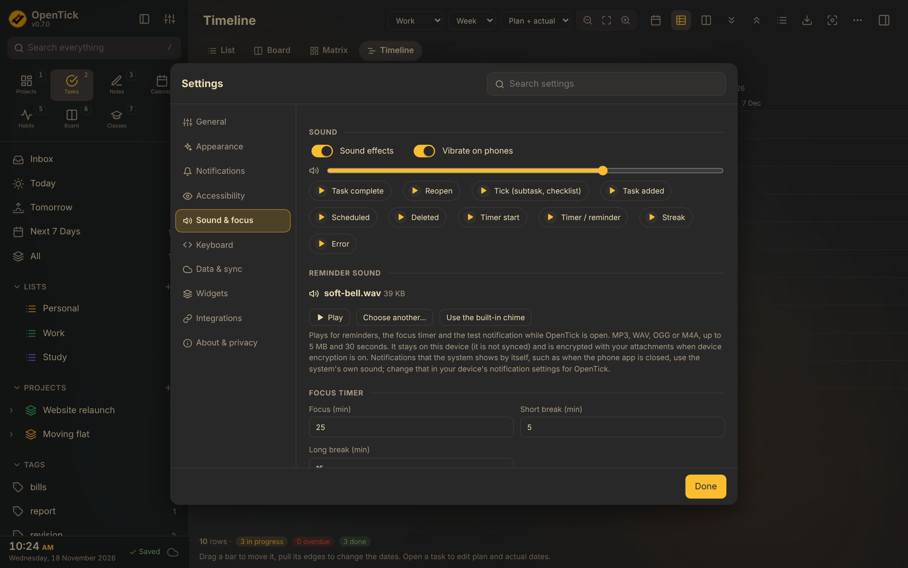

<div align="center">
  

  **A TickTick-style task manager that runs everywhere from one codebase.**

  Plan your day, manage projects and track habits from one codebase. OpenTick is local-first, works offline, and does not require an account, subscription or hosted sync server.
  
---
***Currently AI generated***;
- I intend on one-day "reverting" this project and human-tweaking it until eventually the AI work is subdued (like the ship of Theseus in a way).
---

  <a href="https://unlicense.org"></a>
  <a href="https://tauri.app"></a>
  <a href="https://web.dev/progressive-web-apps/"></a>
  <a href="https://github.com/JebbyCodes/OpenTick/releases/latest"></a>
  <a href="https://github.com/JebbyCodes/OpenTick/actions/workflows/ci.yml"></a>
  <a href="https://github.com/JebbyCodes/OpenTick/actions/workflows/release.yml"></a>
</div>

<!-- screenshots:start -->
<p align="center">
  
  
  
</p>
<p align="center">
  
  
</p>
<!-- screenshots:end -->
<p align="center">
  
</p>

## Download
Get the latest version from [GitHub Releases](https://github.com/JebbyCodes/OpenTick/releases/latest), or choose a platform-specific option below.

<div align="center">
  
### Windows

| Microsoft Store | GitHub Releases |
|:---:|:---:|
| <a href="https://apps.microsoft.com/detail/9pdnntk8tz39?hl=en-GB&amp;gl=GB"></a> | <a href="https://github.com/JebbyCodes/OpenTick/releases/latest"></a> |

| Chocolatey | Scoop |
|:---:|:---:|
| <a href="https://community.chocolatey.org/packages/opentick"></a> | <a href="https://github.com/JebbyCodes/OpenTick-Scoop"></a> |

### Android

| Orion Store | Obtainium |
|:---:|:---:|
| <a href="https://rookieenough.github.io/Orion-Data/redirect.html?id=opentick&amp;icon=https%3A%2F%2Fraw.githubusercontent.com%2FJebbyCodes%2FOpenTick%2Frefs%2Fheads%2Fmain%2Fsrc%2Flogo.png"></a> | <a href="https://apps.obtainium.imranr.dev/redirect?r=obtainium%3A%2F%2Fapp%2F%7B%22id%22%3A%22com.opentick.app%22%2C%22url%22%3A%22https%3A%2F%2Fgithub.com%2FJebbyCodes%2FOpenTick%22%2C%22author%22%3A%22JebbyCodes%22%2C%22name%22%3A%22OpenTick%22%2C%22preferredApkIndex%22%3A0%2C%22additionalSettings%22%3A%22%7B%5C%22includePrereleases%5C%22%3Atrue%2C%5C%22fallbackToOlderReleases%5C%22%3Atrue%2C%5C%22enableVirusTotalScan%5C%22%3Atrue%2C%5C%22observedVersionName%5C%22%3A%5C%220.4.0%5C%22%2C%5C%22observedVersionCode%5C%22%3A4000%2C%5C%22observedPackageId%5C%22%3A%5C%22com.opentick.app%5C%22%7D%22%7D"></a> |

| GitHub Releases |
|:---:|
| <a href="https://github.com/JebbyCodes/OpenTick/releases/latest"></a> |

### Linux

| Snap Store | GitHub Releases |
|:---:|:---:|
| <a href="https://snapcraft.io/opentick"></a> | <a href="https://github.com/JebbyCodes/OpenTick/releases/latest"></a> |

### macOS & Web

| GitHub Releases |
|:---:|
| <a href="https://github.com/JebbyCodes/OpenTick/releases/latest"></a> |
</div>

### Which file do I want?

Every release lists these with sizes, and a `SHA256SUMS.txt` to check them against.

| You have | Download |
|---|---|
| Windows 10 / 11, 64-bit | `OpenTick_x.y.z_x64-setup.exe` (or the `.msi`; `_x64-portable.zip` needs no install) |
| Windows, 32-bit or ARM | `_x86-setup.exe` or `_arm64-setup.exe` |
| Mac (Apple Silicon or Intel) | `OpenTick_x.y.z_universal.dmg` (not notarised: right-click → Open the first time) |
| Linux, 64-bit | `_amd64.AppImage` (any distro), `.deb` (Debian, Ubuntu), `.rpm` (Fedora, openSUSE) or the Snap |
| Linux ARM (Raspberry Pi 4/5, ARM laptops) | `_aarch64.AppImage`, `_arm64.deb`, `.aarch64.rpm` or the ARM64 Snap |
| Android phone or tablet | `_android-universal.apk` works everywhere. Smaller: `_android-arm64-v8a.apk` (modern), `_android-armeabi-v7a.apk` (older, 32-bit), `_android-x86_64.apk` / `_android-x86.apk` (Intel, emulators) |
| Android e-ink device | `_android-eink-universal.apk` (see [E-ink](#e-ink)) |
| Wear OS watch (Pixel Watch, Galaxy Watch 4 and later, TicWatch…) | `_android-watch-universal.apk` (see [Smartwatches](#smartwatches)) |
| Samsung Tizen watch (Galaxy Watch 3 and earlier) | `_tizen-unsigned.wgt`: you sign it yourself first (see [Smartwatches](#smartwatches)) |
| iPhone / iPad | `.ipa` (only when the maintainers' Apple signing is set up; see [docs/RELEASING.md](docs/RELEASING.md)) |
| A server, NAS or any old machine with a browser | Docker, or `_web.zip` (`_web-eink.zip` and `_web-watch.zip` are the e-ink and smartwatch editions) |

Android 7 or newer, Windows 10 or newer and macOS 10.15 or newer are needed. Windows 7/8 and 32-bit Linux are not supported by Tauri 2's web view; use the Docker image or the web app there. Obtainium users can add `apkFilterRegEx` = `universal` (or `arm64-v8a`) to pick one APK from each release.

### Docker

```sh
docker run -d -p 8080:8080 --name opentick ghcr.io/jebbycodes/opentick:latest
```

Open http://localhost:8080 (the e-ink edition is at `/eink/`, the smartwatch edition at `/watch/`). Images exist for 64-bit and 32-bit x86, ARM64 and ARMv7. Your data stays in your browser; the container only serves the app. [`docker/compose.example.yml`](docker/compose.example.yml) is a ready-made compose file.

Every [release](https://github.com/JebbyCodes/OpenTick/releases) also has the image as plain downloads, so you can install without the registry: `OpenTick_<version>_docker-amd64.tar.gz` (also `arm64`, `armv7`, `i386`) loaded with `gunzip -c <file> | docker load`, and a compose file pinned to that version (`OpenTick_<version>_docker-compose.yml`).

## What's new in 0.9.1

**Added**
- **Custom keyboard shortcuts.** Settings → Keyboard now lets you choose the keys: one key, a chord (Ctrl+Shift+K) or a sequence (press G, then T), several keys per action, or none. Record a key by pressing it, or type it in (keyboard-only users get a "Record keys" button, so Tab keeps working; Esc only leaves the recorder). Your choices sync, sealed with the rest of your data; going back to a default is a deletion that syncs too. Before a key is taken OpenTick checks six kinds of conflict: another action (and sequences that start with another action's key), the same key in another place, keys OpenTick needs (Esc, Tab, undo, the editor's Bold / Italic / Link…), keys the browser keeps, keys the operating system keeps (per system), and differences between computers and keyboards (Option on a Mac, AltGr on Windows, layouts). A choice that cannot work somewhere is **kept and switched off there with the reason, marked "Needs attention", never silently changed or dropped**; two choices that meet after syncing are both held until you decide. A choice can be made for one kind of computer only (macOS / Windows / Linux), and each section of your own or of a pack gets "Go to" and "New entry in" actions. Export and import. See docs/SHORTCUTS.md.
- **Pack usage counts (optional, off by default).** Settings → Sections & packs → Pack usage counts lets you help the pack library's website show how many times each pack is *used* ("Used 1,245 times", and a "Most used" sort). Nothing is sent and no code is made unless you turn it on. After that, the first time on a device that you really use a pack you added from the library (saving or ticking off one of its entries, running one of its actions, or choosing one of its themes), OpenTick sends the pack's id and a random code made for that pack on that device, and nothing else: no entries, names, field values, account or device identifier. The code is deleted once the count is received and is never synced; a pack from a file is never counted; downloads and adding a pack are never counted. If the service cannot be reached the count waits and is retried; turning the setting off discards anything waiting. The library's website shows no figures, never a zero, until its usage service is set up. The privacy policy and `docs/PACKS.md` describe it.
- **Advanced fields for sections and packs.** A field can now have a description, a placeholder, a starting value and a *required* mark; a smallest and largest value, whole numbers only, text length, a date range ("not after today") and how many choices or tags; and a look (a unit, a prefix or suffix, decimals, percent, thousands, a progress bar, long or ISO dates). Fields can **appear and disappear** while you fill in an entry (*Shown when* Status is Finished, any or all of up to four conditions), can sit in **groups** with a heading, and a new **Several choices** type has its own search. A new **Calculated** type works a value out from the other fields as you type, with a safe formula language (`min(100, round(100 * [Pages read] / [Total pages], 1))`): it is read by a small parser, never run, so a formula from a pack can only do arithmetic; an empty input gives an empty answer instead of 0, and every error (divide by zero, a circle, a missing field) is shown on the field. **Templates** give a new entry its starting values. Rules are checked as you type (after you have visited a field), a save that breaks one is stopped with every problem named and the first one in focus, and data that arrives from another device or an old pack is **never discarded for breaking a rule, only marked "needs attention"** (with a filter). Packs use them with `"format": 2` (`description`, `placeholder`, `default`, `required`, `min`, `max`, `minLength`, `maxLength`, `integer`, `format`, `group`, `visibleWhen`, `formula`, section `groups` and `templates`); importing checks every value, installing turns the pack's keys into field ids (also inside conditions, formulas and templates), and *Export as a pack* writes it all back. A pack that uses nothing new stays format 1, and a section made before 0.9.1 is stored exactly as before. See docs/PACKS.md.
- **Pack permissions, one at a time.** A pack is still only data and cannot run anything, but it can now *ask* OpenTick to do things for it: an action on an entry ("create a task for this book"), a "related" panel that finds tasks or notes, or a reminder. Nothing is allowed until you say so. Each permission is one capability on one target (for example *search task titles*, *view task summaries*, *create a task*, *mark a task this pack made as done*), never "everything in Tasks", and it can be narrowed to some fields or to the records the pack made or its own entries are linked to. The install screen lists every request with its own tick box (an update shows only what is new, un-ticked), a pack's **Permissions** in Settings → Sections & packs turns each one on or off (or all off), and **Activity** lists what packs did or tried to do, without their contents, with Undo where the app can put it back. A request the app does not implement is refused with a warning, not ignored. The checks happen inside OpenTick on every call, not on the screen. Your decisions sync: turning something off on any device turns it off everywhere, and a device that joins later asks you to confirm them once.
- **Pack reminders.** A pack's section can declare reminders: relative to a date field of the entry ("1 day before *Finish by*", "on the day", several offsets) or repeating (every few days, weeks or months at a time of day, for each entry or once for the whole section). They use the reminder scheduler the app already has for tasks, lessons and countdowns (no second one), so they also fire in the background. You can switch one off for an entry or for the whole section, change its time, add reminders of your own to an entry, and snooze or dismiss; a reminder dismissed on one device stays dismissed on all of them, while each device still notifies for itself. A pack's own reminders need the *create reminders* permission, which is off until you allow it; reminders you add yourself need none.

**Fixed**
- Fixed: **printing no longer puts a thick black border around every page.** With any of the five dark themes (and Match system on a dark computer), the browser painted the whole page margin in the dark colour (the themes ask for a dark colour scheme and print never put it back), so every printed page, and every saved PDF, had a wide near-black frame. Paper is now always light. Borders that belong to the document (the rule under a list's title, tick boxes, table grids) are kept. Tests print real PDFs in every theme and measure the edge of every page. See docs/PRINTING.md.
- Fixed: **Statistics now show the same numbers on every device.** The tally behind Statistics was kept per device and never synced, so a phone and a computer showed different counts for the same account. It is now shared: one small record per device per day, merged by the larger count of each key, so syncing in any order, any number of times, can neither double-count nor lose anything. Everything is sealed like the rest of your data when encryption is on. An older per-device tally is moved into the new records the first time 0.9.1 saves (it is not doubled, and not lost). A device that has History off still shows the counts of your other devices (the switch only controls recording on that device). Resetting or deleting statistics now removes them on all your devices. The History *list* (what happened on this device) still stays on the device.
- Fixed: the licence list (`src/js/licenses.gen.js`) was out of date after dependency updates, which failed the release pipeline's test step. It is regenerated.

**Sync and encryption**
- **The sync file is now schema 8.** It carries five new collections (installed packs, pack permission decisions, pack activity, pack reminders, keyboard shortcuts) and the Statistics tally. Devices still on 0.9.0 or older refuse a schema-8 file with the usual "written by a newer OpenTick" message instead of silently dropping what they do not know: update every device. Statistics, new collections and everything else are sealed inside the encrypted file; nothing new is readable in the cloud file.
- The list of synced collections is now generated from one place (`COLL`), so a new kind of data cannot be left out of sync, snapshots, backups or the fingerprint, and a test fails if a collection is not covered by the two-device encrypted sync test.
- Merging can now use a per-collection rule, and a copy that was deleted at least as recently as it was edited takes no part in it (a stale copy cannot bring a reset or a revoked record back).

**Project**
- **Screenshots of the released app, taken automatically.** A new workflow, *Update screenshots*, downloads the latest stable release's web zip (checking its size, its line in `SHA256SUMS.txt` and its signed attestation; it stops with a message rather than falling back to the source), opens it in a clean browser with invented data and a stopped clock, takes nine pages at a desktop and a phone size, and opens a pull request with the new pictures, a `metadata.json` naming the release, and the README gallery. It does nothing when the pictures already show that release. It is started by the Release workflow for stable releases, by a published release, every Monday and by hand, and it never pushes to `main`. See [docs/SCREENSHOTS.md](docs/SCREENSHOTS.md), including the repository setting the pull request needs. It has not yet run on GitHub: the README keeps its older hand-made pictures until its first pull request is merged.

Earlier releases are listed in [CHANGELOG.md](CHANGELOG.md).

## E-ink

For e-paper tablets and readers (Boox, reMarkable-style browsers, Kindle browsers, Kobo…): Settings → Appearance → **E-ink display** switches to black on white with outlines instead of colour, no animation or shadows, bigger touch targets, marks instead of colour, and **page up / down buttons** on the edge for scrolling without a flick. *Automatic* turns it on for known e-reader browsers and for the e-ink builds below.

- **Android:** `_android-eink-universal.apk` from a release starts in e-ink mode (it can be turned off in Settings).
- **Web:** open `/eink/` on the hosted site, in the Docker image, or in `_web-eink.zip`. Any other browser can add `?eink` to the address.

## Smartwatches

The **smartwatch layout** is the same app, data, sync and encryption drawn for a small round or square screen: six full-screen pages you swipe between (Now, Tasks, Next, Habits, Focus, More) with a big tick for each task, Add by typing or dictating, the day's timetable, habit check-ins and the focus timer.

- **Wear OS 3 or newer** (Pixel Watch, Galaxy Watch 4 and later, TicWatch and others): `_android-watch-universal.apk` from a release, installed with `adb`.
- **Samsung's older Tizen watches:** `_tizen-unsigned.wgt`. Samsung only runs apps signed with the installer's own certificate, so it is published unsigned. This one is experimental.
- **Web:** open `/watch/` on the hosted site, in the Docker image, or in `_web-watch.zip`. Any other browser can add `?watch` to the address, or choose Settings → Appearance → **Smartwatch layout**.
- **Not possible:** Apple Watch, Garmin, Fitbit and Zepp watches need an app written for each of them. Reminders can still reach them as the phone's notifications.

[docs/WATCHES.md](docs/WATCHES.md) has the install steps and an honest list of what has and has not been tried.

## Features

- **Tasks and lists:** priorities, tags, sections, subtasks, recurring tasks, reminders, attachments and batch editing.
- **Quick add:** natural-language dates, times, repeats, priorities, tags, lists and class markers.
- **Add many at once:** type or paste a list into *Add from text* (Shift + A) to make tasks, events, timeline items, timetable slots, notes, habits or countdowns, with a button that copies the format for an AI to write for you.
- **Statistics (optional):** a heatmap and charts of what you do, filtered by type, action, list or project, and shareable as an image. It needs History, which is off by default and stays on your device.
- **Link by tags and in notes:** anything with the same tag links to the others, and notes can show live task cards, task properties and tag lists.
- **Print:** notes, task lists, calendar, timetable, boards, habits and statistics.
- **Planning views:** calendar, kanban board, projects dashboard, Eisenhower matrix and Gantt chart.
- **Your own layout:** right-click (or press and hold) any page title or tab to pin it next to the sections, and put the sections and pins in the order you like.
- **Contacts:** the people you work and study with, with available hours, emails, phone numbers and notes, linked to tasks, notes and classes, `@mentions`, and your teachers from Classes.
- **Your own sections and packs:** make a section for anything (reading list, recipes, spending) with the fields you choose, and share sections and colour themes as small files. Packs have short codes: type one in Settings to add it, or browse the [pack library](https://github.com/JebbyCodes/OpenTick-Packs) (and add your own by pull request). The format is in [docs/PACKS.md](docs/PACKS.md).
- **Timetable and Classes:** recurring weekly slots, lessons, A/B weeks, days off, exams and homework.
- **Habits and focus:** streaks, history charts, and a Pomodoro timer with session tracking.
- **Reminders:** several per task, in the background on every platform, with a sound of your choosing.
- **Markdown notes:** preview, checklists, note links, attachments and import/export.
- **Customisation:** themes, custom CSS themes, colours, banners, adjustable panels and keyboard shortcuts.
- **Widgets:** desktop mini-window, Android home-screen widgets (tasks, lists, projects, notes, calendar, timetable, matrix, habits, countdowns, focus) and a compact web widget.
- **Offline-first storage:** data stays on your device unless you enable sync.
- **Optional encryption:** AES-256-GCM encryption for selected local data, backups and cloud sync, protected by a passphrase and recovery key.
- **Flexible sync:** WebDAV or a JSON file in a folder synced by another app; additional Git and S3-compatible providers are available.
- **Import and export:** JSON backups and imports from several task and note formats.
- **Updates on your terms:** an optional update check, off by default; nothing is ever downloaded or installed for you.

## Platforms

| Platform | How to run it |
|---|---|
| Web / PWA | Use the hosted site, the Docker image or `_web.zip` (serve over HTTPS for PWA install), or build `dist/` yourself. |
| Windows | Installer, MSI, portable zip or Store package; 64-bit, 32-bit and ARM64. |
| macOS | Universal `.dmg` (Apple Silicon and Intel). |
| Linux | AppImage, `.deb`, `.rpm` or Snap; 64-bit and ARM64. |
| Android | Universal APK, per-CPU APKs (including 32-bit ARM), an App Bundle, an e-ink APK and a Wear OS APK. |
| iOS | `.ipa` built with Apple signing configured, or build from source in Xcode. |
| E-ink | Android e-ink APK, the `/eink/` web edition, or E-ink display in Settings. |
| Smartwatch | Wear OS APK, an unsigned Tizen package, the `/watch/` web edition, or Smartwatch layout in Settings. |

## Build from source

### Requirements

- [Node.js](https://nodejs.org/)
- For desktop builds: [Rust](https://www.rust-lang.org/) and the [Tauri prerequisites](https://tauri.app/start/prerequisites/)
- For Android: Android SDK/NDK and Java
- For iOS: macOS, Xcode and Apple signing configuration

### Web / PWA

```sh
git clone https://github.com/JebbyCodes/OpenTick.git
cd OpenTick
npm install
npm run build:app
```

The built app is in `dist/`. Serve that directory over HTTPS to enable PWA installation and service-worker features.

### Development

```sh
npm install
npm run dev
```

### Desktop

```sh
npm run icons
npm run tauri dev
npm run tauri build
```

### Android

```sh
npx tauri android init
npx tauri android dev
npx tauri android build --apk
```

### iOS

```sh
npx tauri ios init
npx tauri ios dev
npx tauri ios build
```

iOS device builds need signing configured in Xcode. For platform-specific setup, follow the [Tauri documentation](https://tauri.app/).

## Data and privacy

OpenTick stores tasks and settings locally by default. Sync is optional.

- **Local data:** app data is stored in browser storage; attachments use IndexedDB.
- **Backups:** export your data to JSON and use the app's automatic local snapshots.
- **Sync:** use WebDAV or a supported file/provider option. Keep device clocks reasonably accurate because record conflicts are resolved using timestamps.
- **Encryption:** optional. Keep your recovery key somewhere safe; encrypted data cannot be recovered without the passphrase or recovery key.
- **WebDAV:** use HTTPS, especially on Android. Web/PWA sync can also require the server to allow browser CORS requests.

## Tests

Run the main test suite:

```sh
npm test
```

Browser tests (Python + Playwright with Chromium) run with `npm run test:browser`. `npm run lint:workflows` checks the GitHub workflow files, and `npm run version:check` confirms every file carries the same version.

## Project structure

- `src/` — application HTML, CSS and JavaScript
- `src-tauri/` — Tauri desktop/mobile shell and platform assets (`android-widgets/` holds the Android Kotlin and XML)
- `test/` — Node test suites; `test/browser/` has the Playwright tests
- `scripts/android/` — widget and service installer, signing, version check, APK naming
- `scripts/release/` — `bump-version.mjs` (`npm run bump` / `version:sync`), release notes, asset collection
- `scripts/legal/` — licence and privacy-policy generators
- `scripts/assets/`, `scripts/ci/`, `scripts/screenshots/` — icon generation and the smartwatch picture (`readme-screenshots.py`); the workflow linter; the automated screenshots of the released app ([docs/SCREENSHOTS.md](docs/SCREENSHOTS.md))
- `scripts/watch/` — the Tizen smartwatch package (`make-tizen-wgt.mjs`)
- `packaging/msix/` — Microsoft Store package: manifest, assets, `build-msix.ps1`, `bundle-msix.ps1`
- `snap/` — `snapcraft.yaml` (builds from source) and `ci/` + `local/` (wraps the CI-built `.deb`)
- `Dockerfile`, `docker/` — the self-hosting image
- `.github/workflows/` — `ci`, `release`, `build-*`, `publish-*`, `deploy-pages` (see [docs/RELEASING.md](docs/RELEASING.md))
- `docs/` — privacy policy, F-Droid recipe, release guide, smartwatch guide
- `build-app.mjs` — creates the self-contained web build (`--eink` for the e-ink edition, `--watch` for the smartwatch edition, `--out <dir>`)
- `package.json` — project version and commands

## Contributing

Bug reports and feature requests are welcome in [GitHub Issues](https://github.com/JebbyCodes/OpenTick/issues). For code changes:

1. Fork the repository and create a branch.
2. Run `npm install` and `npm test`.
3. Explain user-visible changes in the pull request and update `CHANGELOG.md` when appropriate.

## License

OpenTick is released under the [Unlicense](https://unlicense.org/). You can copy, modify, distribute and use it commercially.

## Acknowledgements

- [Tauri](https://tauri.app/) for the native application shell.
- The open-source *Timetable* app for the lesson-timetable model behind Classes.
- The authors of the themes and open-source projects whose formats OpenTick supports.
