# Screenshots of the released app

The pictures in the README and on this page are **photographs of the app people actually download**, taken automatically after each stable release, with invented data. Nobody has to remember to retake them, and none of them comes from a developer's own computer or from unreleased source code.

Everything is in `scripts/screenshots/` and `.github/workflows/update-screenshots.yml`.

## What is photographed

Nine pages, each at a **desktop** size (1440 × 900) and a **phone** size (390 × 844 at 2× scale, touch), so 18 pictures:

| Page | What is on screen |
|---|---|
| dashboard | the Projects page (the dashboard) |
| tasks | Today, with one task open |
| notes | the notes list and a note |
| calendar | the month view |
| habits | habits and streaks |
| boards | a board (To do, Doing, Done) |
| sections | a custom section built from a pack (a reading list) |
| packs | Settings, Sections & packs: the packs added to the app |
| integrations | Settings, Integrations |

The data (`scripts/screenshots/demo.js` and `demo/study-planner.pack.json`) is made up: invented lists, tasks, notes, habits, a board and a small pack. It is loaded **by the app itself** (it calls the app's own functions and lets it save), so the screenshots show data stored the way the app stores it. Nothing comes from a real profile, account or device. The clock is stopped at Wednesday 18 November 2026, 10:24, so there are no unpredictable times or notifications and every run draws the same thing. Every picture is taken in a **brand-new browser profile** (no storage, cookies or cache from any other picture), animations are switched off, nothing is focused or hovered, and the browser is only allowed to talk to the local server: if the app tries to reach anything else, the run stops.

The smartwatch picture in the README (`docs/images/watch.png`) is the one that is **not** automated. The watch layout is a separate edition and is still made by hand with `scripts/assets/readme-screenshots.py`.

## How a run goes

1. **Find the release.** The GitHub Releases API is asked for the newest release that is neither a draft nor a pre-release (or the tag it was given, which must also be stable).
2. **Download and check its web zip.** The file must be called exactly `OpenTick_<version>_web.zip`. Its size and SHA-256 must agree with what GitHub lists, with its line in the release's `SHA256SUMS.txt`, and `gh attestation verify` must accept its signed build attestation (the release workflow signs every file).
3. **Stop if nothing is new.** When the pictures in the repository already show this release (the same zip), the run ends here. This is what the weekly check normally does, and it is why a new browser version never fills a pull request with redrawn but identical pictures. Run it by hand with *force* to take them again.
4. **Photograph.** The zip is unpacked safely (no paths outside the folder, no links, bounded size), checked to be the web edition of that version, served on `127.0.0.1`, and opened in Chromium with Playwright.
5. **Publish as a pull request.** The pictures, `metadata.json` and the generated blocks of the README and of this page go to the branch `bot/screenshots`, and one pull request is opened (or the existing one is updated). **Nothing is pushed to `main`.** A person looks at the pictures and merges.

**If the release or its zip is missing or does not check out, the run fails with the reason. It never falls back to the development source.** (One exception that is not a fallback: when it is started by a release event it waits up to ten minutes for the files of a release that was only just published.) The run also fails if the app throws an error or logs a console error, tries to reach another computer, or a picture comes out blank, so a broken set is never published. Whatever was taken is kept as the run's artifact `screenshots` for two weeks, so a failed run can be looked at.

### When it runs

| Start | Why |
|---|---|
| **Release** workflow | Called for every stable release, with its tag. **This is the path that matters.** The release is created with the built-in `GITHUB_TOKEN`, and GitHub does not start workflows that wait for a "release published" event after something created with that token, so Release calls this workflow itself, the same way it calls the store publishers. |
| a release is **published** | For a release made another way (by hand, or with a personal token). Drafts and pre-releases are ignored. |
| every Monday | A safety net: it finds a stable release that no run has photographed. It normally stops at step 3. |
| *Run workflow* | By hand, with an optional tag and *force*. |

It cannot run twice at once (a second start waits and then finds nothing new), and it cannot start itself: it writes only a branch and a pull request, and no trigger listens to either.

## One-time repository settings

* **Settings → Actions → General → "Allow GitHub Actions to create and approve pull requests"** must be on, or the run stops after pushing the branch and says so. (Open the pull request from `bot/screenshots` by hand if you prefer.)
* GitHub does not start other workflows for a pull request opened with the built-in token, so the tests will not run on it by themselves. Either close and reopen the pull request, or add a repository secret **`SCREENSHOTS_TOKEN`** (a fine-grained personal access token or a GitHub App token with *Contents* and *Pull requests* write access). The workflow uses it, when it exists, to push and open the pull request, and the tests then run.
* Do not push to `bot/screenshots` yourself: the workflow replaces that branch each time.

## Run it on your own machine

You need Python 3 with `pip install playwright Pillow` and `python -m playwright install chromium`.

From the **latest stable release** (the same first steps the workflow takes; the attestation check needs the `gh` command):

```sh
python3 scripts/screenshots/fetch-release.py --out .build/shots
gh attestation verify .build/shots/OpenTick_*_web.zip --repo JebbyCodes/OpenTick
python3 scripts/screenshots/capture.py --site .build/shots/site --out .build/shots/images
python3 scripts/screenshots/publish.py apply --release .build/shots/release.json --images .build/shots/images --dry-run
```

`--dry-run` says what would change and writes nothing. Without it, `publish.py apply` writes the pictures, `metadata.json` and the README and docs blocks into your working copy (`--force` replaces newer pictures with older ones; leave it out).

To **try the pictures on a build of your own** (before a release exists), use a local zip. These pictures are for looking at only: `publish.py` refuses them.

```sh
node build-app.mjs --out .build/site
(cd .build/site && zip -qr ../OpenTick_0.9.1_web.zip .)
python3 scripts/screenshots/fetch-release.py --out .build/shots --from-zip .build/OpenTick_0.9.1_web.zip --version 0.9.1
python3 scripts/screenshots/capture.py --site .build/shots/site --out .build/shots/images
```

`capture.py --only dashboard,tasks` takes just those pages. `.build/` is ignored by git.

## Changing what is photographed

* **The data:** `scripts/screenshots/demo.js` and `demo/study-planner.pack.json`. Use only invented names and dates. It calls long-standing app functions; if a release renames one, the capture stops with the error and this is the file to fix.
* **The pages:** `SCENES` in `capture.py` (how to get to each page, and a text that must be on screen so a wrong page is caught) and `PAGES`, `README_DESKTOP`, `README_MOBILE`, `WHAT` in `publish.py`. A test keeps the two lists equal.
* **Which pictures the README shows:** `README_DESKTOP` and `README_MOBILE` in `publish.py`. All 18 are in the table below.
* **The README and this page** keep the text outside their `<!-- screenshots:… -->` markers; only what is between the markers is generated. Keep the markers in place.

## What is recorded

`docs/images/screenshots/metadata.json` says which release the pictures show (tag, version, link, the zip's name, size and SHA-256), the stopped clock and the viewport sizes, and holds a SHA-256 for every picture. It has no capture time, so an identical re-run changes nothing. A pull request has the same facts in its description.

## What has and has not been checked

Checked by `test/browser/test_screenshots.py` (part of `npm run test:browser`): the download and checks against a **stand-in release server** (the newest stable release is chosen over drafts and pre-releases; every failure above stops with its message and does not fall back; a missing file is waited for only when asked); safe unpacking; the e-ink edition and a wrong version are refused; the capture itself in a real browser (18 pictures, the same on a second run to within anti-aliasing: at most 0.2% of pixels differ clearly, stops on an app error or an outside request); and `publish.py` (only changed pictures are written, an identical run changes nothing, an older release does not replace a newer one, local or unverified or foreign pictures are refused, stale pictures are removed).

**Not checked from where this was written:** a run on GitHub itself. The real Releases API, a real download, `gh attestation verify` against a real attestation, pushing the branch, opening the pull request, the `release: published` event and the Release workflow's call have all been written to GitHub's documented behaviour and the workflow file has been linted, but none of them has run. The first real run, after the next stable release, is the test of those, so read its log. Browser versions differ between machines: the same app can differ by a few pixels of anti-aliasing between two runners, which is why a release is photographed once.

## The pictures

<!-- screenshots:list:start -->
<!-- Generated by scripts/screenshots/publish.py. Edit the workflow or the scenes, not this block. -->
These are pictures of **OpenTick 0.9.1** ([v0.9.1](https://github.com/JebbyCodes/OpenTick/releases/tag/v0.9.1)), taken from that release's web zip `OpenTick_0.9.1_web.zip` (SHA-256 `454567d2edb297e3b48b8ce16a315be2bc185bacb2dc56e1f7381c13e9e10a7d`), with invented data and the clock stopped at 2026-11-18T10:24:00. [`metadata.json`](images/screenshots/metadata.json) records this and a SHA-256 for every picture.

| Page | Desktop | Phone |
|---|---|---|
| **Dashboard**<br>The dashboard: today, the week and the projects at a glance | 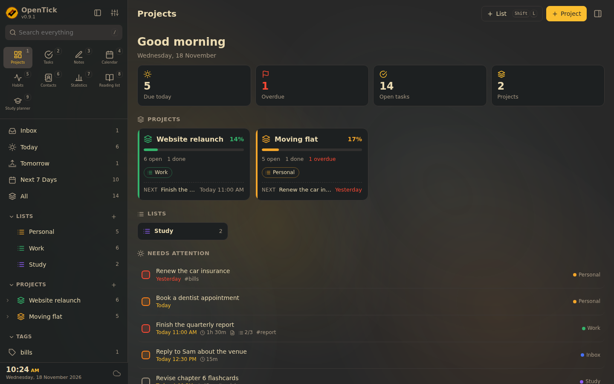 | 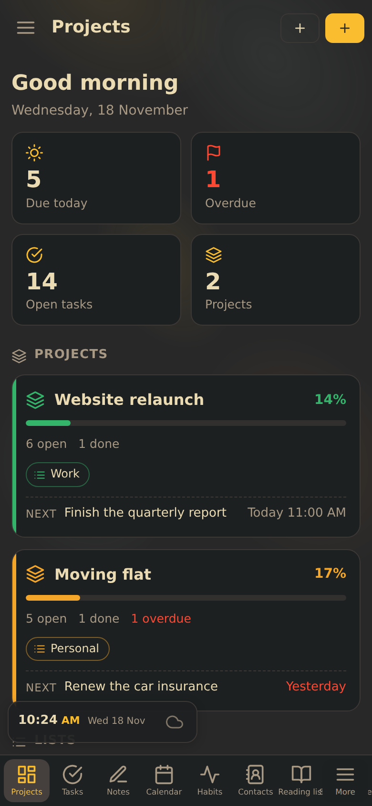 |
| **Tasks**<br>Today's tasks, with one open for editing | 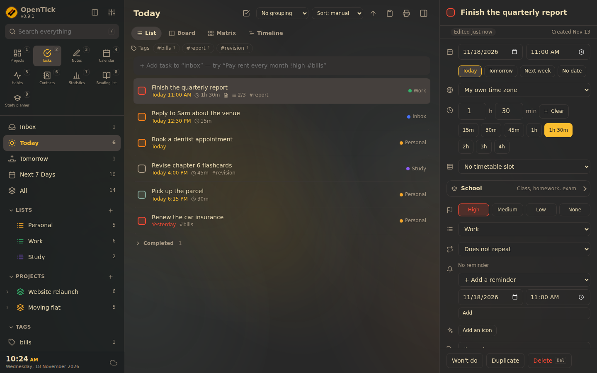 | 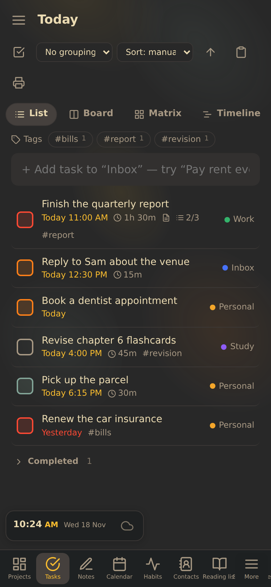 |
| **Notes**<br>Notes, with a note open next to the list | 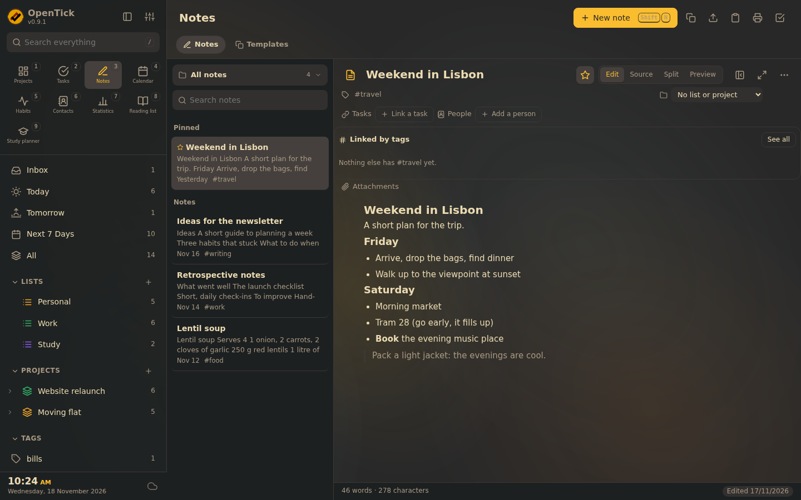 | 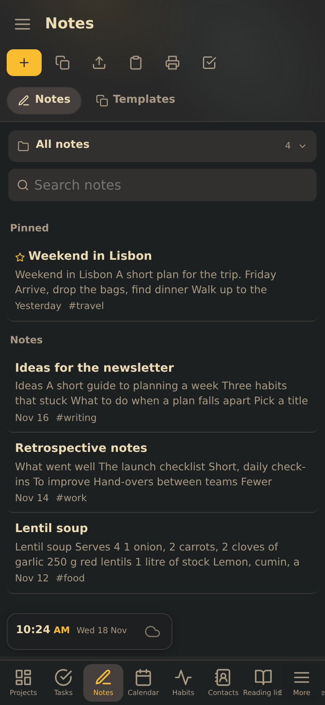 |
| **Calendar**<br>The calendar's month view with tasks on their days | 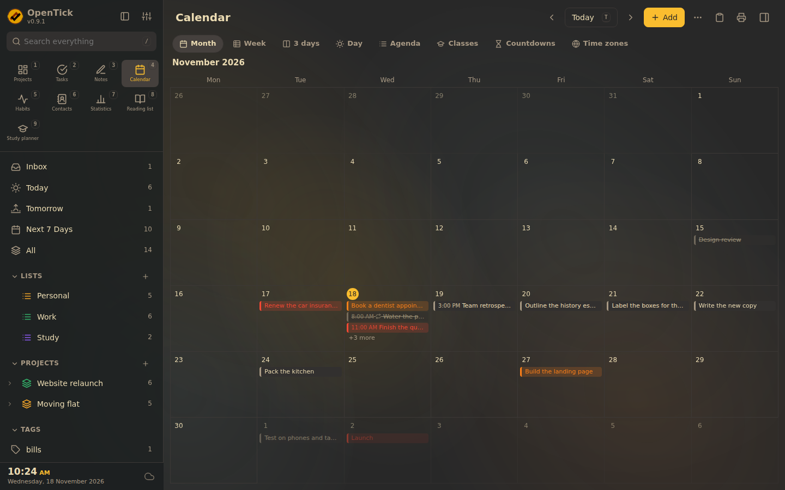 | 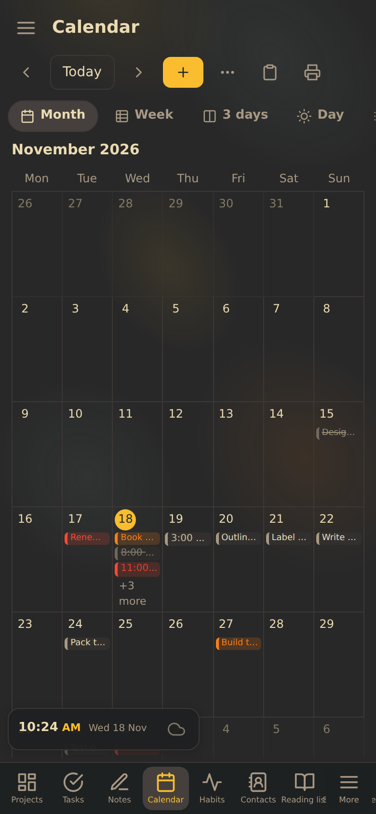 |
| **Habits**<br>Habits and their streaks | 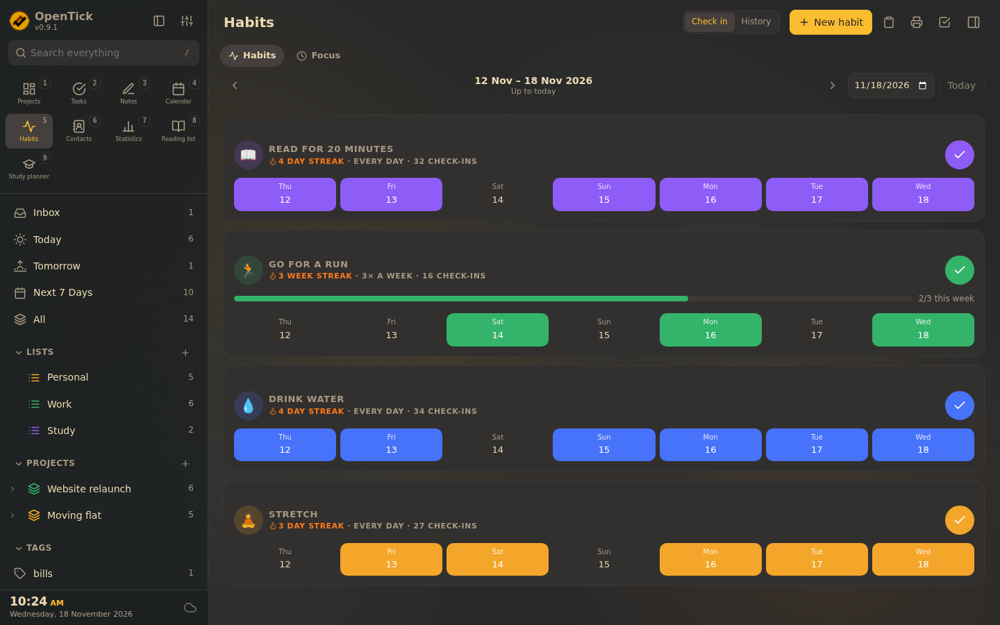 | 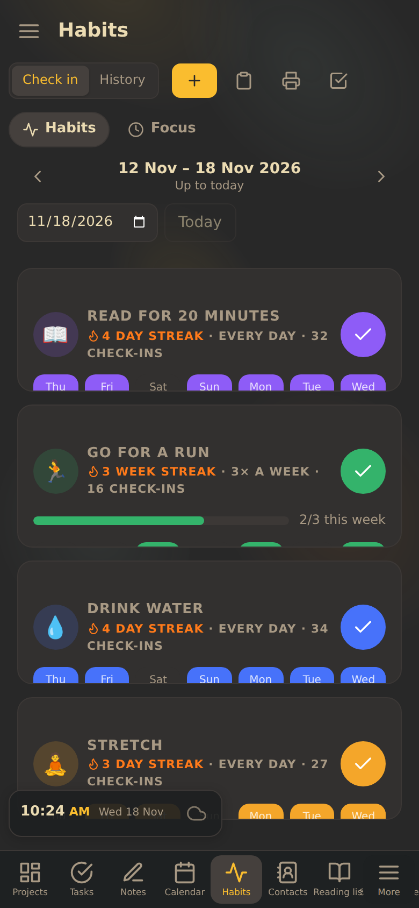 |
| **Boards**<br>A board: cards moving from To do to Done | 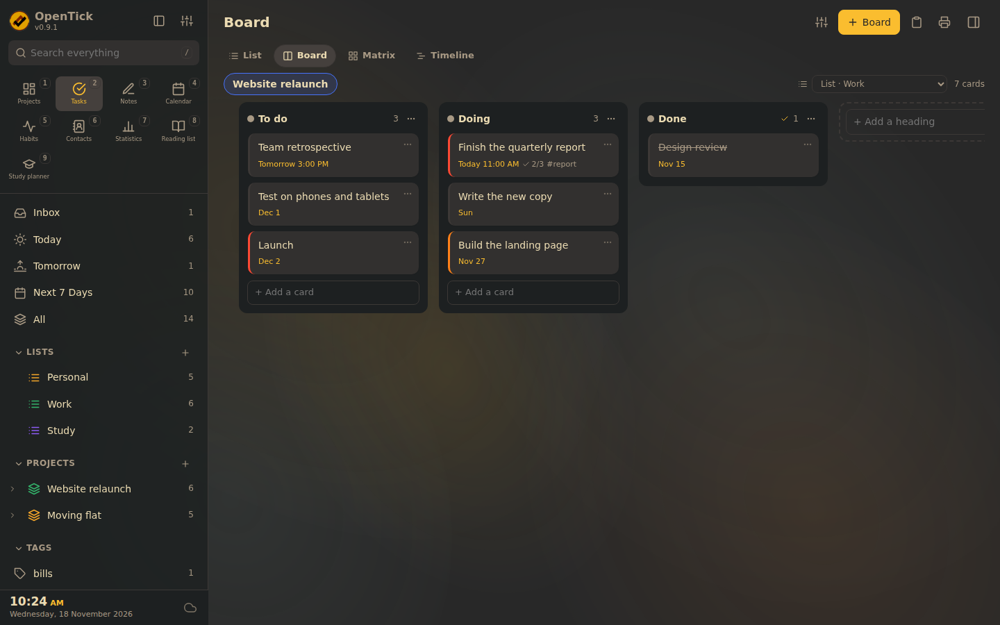 | 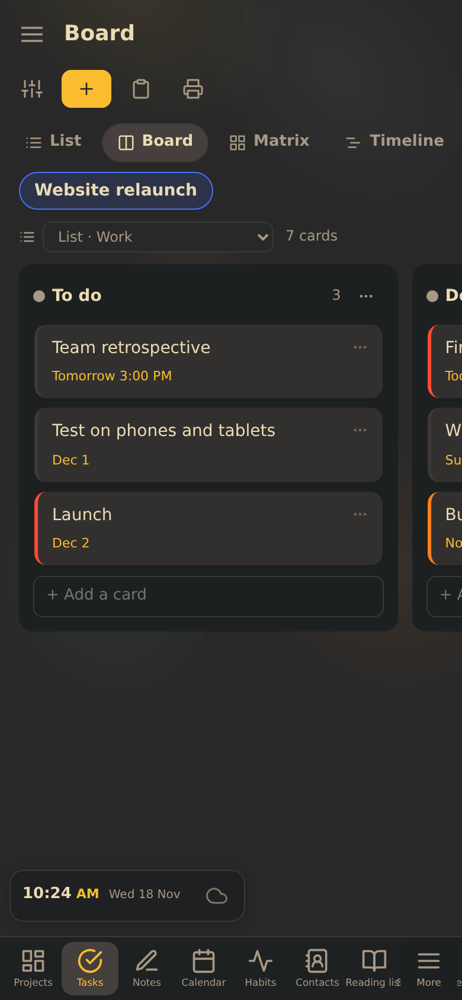 |
| **Sections**<br>A custom section built from a pack: a reading list | 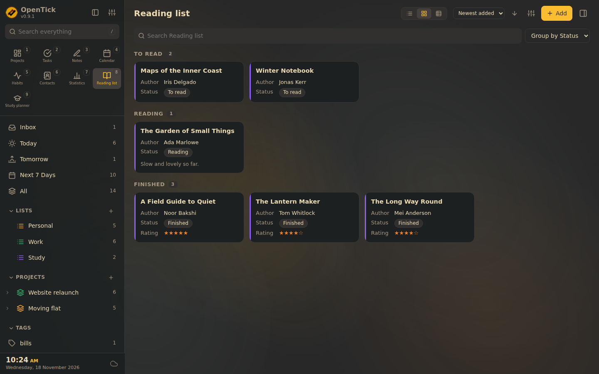 | 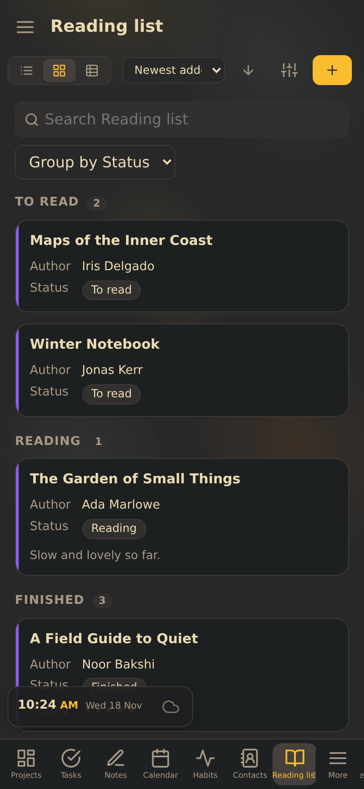 |
| **Packs**<br>Settings: the packs added to the app | 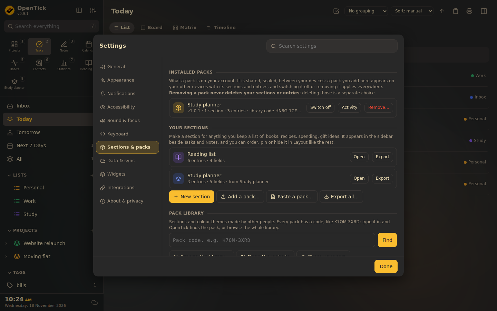 | 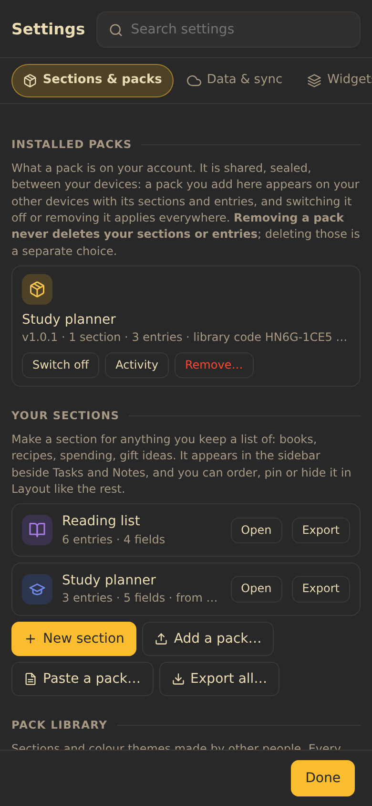 |
| **Integrations**<br>Settings: connecting other apps (off until you allow it) | 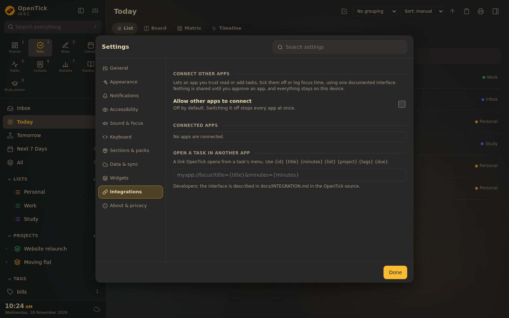 | 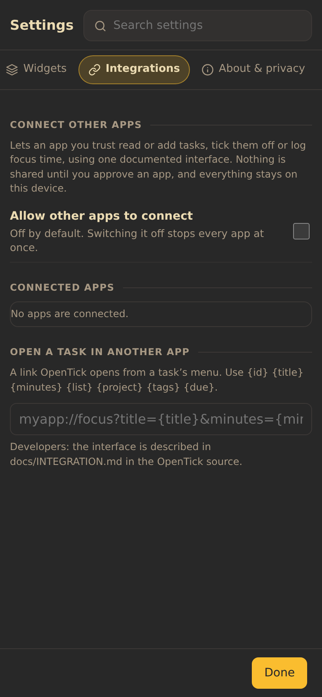 |
<!-- screenshots:list:end -->
